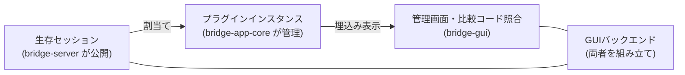

# ブリッジアプリ

アプリの三層責務、プラグインと割当ての契約、GUI境界を決める。

形状（型・フィールド名・操作名・定数値）はコードを正本とし、ここでは複製しない。接続認可・切断失効・サーバー管理境界としての公開は[ブリッジ接続](bridge-connection.md)、輸送・配送・方向・終了の契約は[プロトコル](protocol.md)を正本とする。

三層の関係は、公開された生存セッションを割当てで結び、画面に埋め込む大枠である。詳細は本文に置く。

## 三層の責務

| 層                         | 担うこと                                                                                                         |
| -------------------------- | ---------------------------------------------------------------------------------------------------------------- |
| `bridge-server`            | 接続前検証・ペアリング・Connection認可・輸送・生存セッションの公開・輸送統計                                     |
| `packages/bridge-app-core` | プラグイン定義とインスタンス管理、接続口の適合判定、割当て・解除、失効処理、UI非依存の状態と操作、同梱プラグイン |
| `apps/bridge-gui`          | 起動・終了、管理画面、比較コード照合、プラグインUIの埋込み、デスクトップ機能、画面との通信                       |

- `bridge-app-core` はサーバー管理境界を受け取り、GUIライブラリを参照しない。GUIのバックエンドが両者を組み立てる。
- 埋込み画面（Webview）へ `BridgeServer` や生の `Session` を渡さない。表示用データと限定した操作だけを渡す。

## サーバーが公開するセッション口

- 生存セッションの一覧取得と取得口を `BridgeServer` の管理境界に追加する。
- 管理イベントに、セッション開始・セッション終了・接続状態変更を追加する。
- データの購読・送信・終了は既存の Session API（`onMessage`・`onEnd`・`onRemoteEnd`・`sendReliable`・`abort` 等）を再利用し、サーバー独自の登録機構は設けない。
- サーバー起点のセッション作成は公開しない。
- `sessionId` は別接続でも同一接続の終了後でも再利用され得るため、表示・関連付け情報としてのみ扱い、それだけで古い割当てを識別しない。再利用しないローカルのセッション識別子を別途導入する。
- 契約は以下とする。
  - 認可後のセッションだけを公開する。承認成功や切替中は利用開始ではない。
  - 登録を確定してから開始通知、一覧から除外してから終了通知を行う。終了通知は一度だけとする。
  - Connection の終了開始時に全セッションを失効させる。物理切断待ちまで利用可能にしない。
  - FIN は片方向終了であり、全体終了（`onEnd`）と区別する。
  - 通知は購読者の例外を隔離する。購読から一覧取得で初期同期でき、アプリ側は識別子で重複を除く。
- 名称・型の詳細はコードを正本とし、ここでは複製しない。CLI にもセッション公開は波及するが、GUI 向けの割当て操作は CLI に追加しない。

## プラグイン

- プラグインは本体機能と UI を持ち、UI は埋込み Webview として表示する。
- レシピ的に扱い、複数インスタンスを出せる。
- 初期対象はリポジトリに同梱する信頼済みプラグインに限る。外部の非信頼プラグイン読込みは対象外とする。
- セッションで送受信するデータの内容やプロトコルに、基盤は関心を持たない。

## 接続口と capability

- プラグインは名前付きの接続口を宣言する。各接続口は、受け入れる合法な `kind`・`direction` の組合せを列挙する。二つの独立した集合にはしない。
- 方向は常にワールド・サーバー基準とする。プラグイン基準に読み替えない。
- 現在利用可能な組合せは以下とする。
  - `reliable`・`bidirectional`：PC 側は送受信可能。
  - `latest`・`to_server`：PC 側は受信のみ。
  - `latest`・`to_client`：PC 側は送信のみ。サーバー起点作成をしない今回の範囲では利用不可。
- capability の一致は輸送上の適合にすぎず、データ内容の互換性は保証しない。データの検証・応答相関はプラグインの責務とする。

## 割当て

- 割当てはローカルのセッション識別子からインスタンス識別子と接続口識別子への対応で表す。
- 初期は一対一（一つのセッションに一つの割当て、一つの接続口に一つのセッション）とする。分配・合流は持たない。
- プラグインには割当て期間だけ有効な操作口を渡す。解除後の送信・購読は禁止する。
- 解除・インスタンス削除は対象セッションを中断する。切替えは新しいセッションを使い、未決着通信を混在させない。
- 再接続・同名セッションへ割当てを自動継承しない。
- 未割当ての `reliable` セッションにデータが届いた場合は、理由付きでそのセッションを中断する。GUI 操作待ちの無制限保留や黙った破棄はしない。
- 後から接続するプラグインへの過去値の再配信は保証しない。初期契約は割当て後の受信とする。

## 診断

- 応答確認相当（echo・ping）は `bridge-app-core` の同梱診断プラグインへ移す。プラグイン基盤本体には診断の解釈を持たせない。
- CLI は診断インスタンスを生成・割当てすることで診断用途を維持する。
- 輸送統計から診断 echo・ping の項目を削除する。互換用フィールドは残さない。
- 輸送の keepalive Ping はサーバー側に残す。診断 ping とは別機能である。
- `latest` の記録（内容を解釈しない既存機能）と関連統計は今回維持する。ただし接続をまたぎ切断後も残る記録であり、生存セッションや割当ての判定には使わない。

## 対象プラットフォームと GUI 基盤

- 対象は macOS（Apple Silicon）を最優先とする。Electrobun は macOS x64 を提供しないため、Intel Mac は対象外とする。
- GUI 基盤は Electrobun を採用する。ベータ段階・単一メンテナというリスクは許容し、埋込み・配布・実行互換に問題が出た場合は Electron へ切り替える。その場合も本節の三層境界は維持する。
- 非目標は以下とする。サーバー起点のセッション作成、外部の非信頼プラグインの実行、分配・合流、通信途中のプラグイン付替え、認可や割当ての継承、汎用の接続管理 UI・永続化・複数 Webview 管理（後工程）。

## 文書の正本分担

- 本文書：三層の責務、プラグインと割当ての契約、未割当て・解除方針、GUI 境界、非目標、採用理由と見直し条件。
- [ブリッジ接続](bridge-connection.md)：Connection 認可・切断失効、サーバー管理境界としてのセッション公開。
- [プロトコル](protocol.md)：輸送・配送・方向・終了の契約。
- コード：公開型・フィールド・操作名・データ形状。
- [接続の検証計画](../docs/verification/bridge-connection.md)：接続の検証計画。[アプリの検証計画](../docs/verification/bridge-app.md)：アプリ固有の観測。

## 見直し条件

- 実行情報：Electrobun で直接実行できるならこの構成で進める。別プロセスが必要なら IPC・監視・終了処理の増加を示して再相談する。埋込み・配布・実行互換に問題があれば Electron へ切り替える。境界は維持する。
- 再相談：ローカル操作を行うプラグイン、非信頼コードの実行、分配・合流、通信途中の付替え、認可や割当ての継承が必要になった場合。
- capability の一致を権限判定として扱わない。既存の接続認可はあらゆるローカル操作の包括承認ではない。
