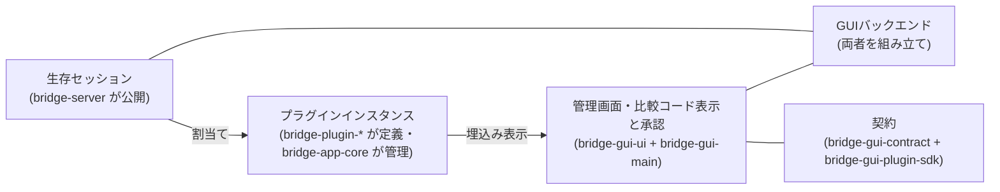

# ブリッジアプリ

アプリの三層責務、プラグインと割当ての契約、GUI境界を決める。

形状（型・フィールド名・操作名・定数値）はコードを正本とし、ここでは複製しない。接続認可・切断失効・サーバー管理境界としての公開は[ブリッジ接続](bridge-connection.md)、輸送・配送・方向・終了の契約は[プロトコル](protocol.md)を正本とする。

三層の関係は、公開された生存セッションを割当てで結び、画面に埋め込む大枠である。画面と backend が共有する手段だけを `bridge-gui-contract` に置き、プラグイン実装者が参照する公開契約は `bridge-gui-plugin-sdk` に置く。具象プラグインの本体・GUI companion・子画面は種別ごとのパッケージ（`packages/plugins/bridge-plugin-*`）が所有する。同梱の選択と登録順は composition root が宣言する。詳細は本文に置く。

## 三層の責務

| 層                                          | 担うこと                                                                                                                                                                                                                                                                           |
| ------------------------------------------- | ---------------------------------------------------------------------------------------------------------------------------------------------------------------------------------------------------------------------------------------------------------------------------------- |
| `bridge-server`                             | 接続前検証・ペアリング・Connection認可・輸送・生存セッションの公開・輸送統計                                                                                                                                                                                                       |
| `packages/bridge-app-core`                  | プラグイン定義とインスタンス管理、接続口の適合判定、割当て・解除、失効処理、UI非依存の状態と操作。汎用基盤だけを持ち、具象プラグイン・テキスト通信契約を公開しない。root と `./core` の公開内容は同一である                                                                        |
| `packages/bridge-gui-contract`              | 共有契約（管理RPC・中継 envelope・配置・表示要求・初期応答状態と微少ランタイム）。`management`／`plugin-instance`／`dev-console` の subpath を分ける。`plugin-instance` が持つのは中継の共通形と配置・表示要求だけであり、子画面固有契約は持たない                                 |
| `packages/bridge-gui-plugin-sdk`            | プラグイン実装者が参照する公開契約（管理記述子・束縛個体限定の参照口・割当て方針・companion 宣言・endpoint 工場・emission port・登録口・資産宣言）。具象 import・副作用・実行実体・ホストパス参照を持たない                                                                        |
| `packages/plugins/bridge-plugin-text`       | テキストプラグインの所有者（本体・テキスト通信契約・子画面固有契約・管理記述子・endpoint 工場・GUI アダプター・資産宣言・子画面）。公開 entry は `.`・`./contract`（ブラウザ安全）・`./gui-contract`（実行環境非依存）・`./gui`・`./assets` である                                 |
| `packages/plugins/bridge-plugin-diagnostic` | 診断プラグインの所有者（本体・診断通信契約・子画面固有契約・管理記述子・endpoint 工場・GUI アダプター・資産宣言・子画面）。公開 entry は `.`・`./contract`（ブラウザ安全）・`./gui-contract`（実行環境非依存）・`./gui`・`./assets` である                                         |
| `packages/plugins/bridge-plugin-udp`        | UDPプラグインの所有者（本体・UDP通信契約・子画面固有契約・管理記述子・endpoint 工場・GUI アダプター・資産宣言・子画面）。公開 entry は `.`・`./contract`（ブラウザ安全）・`./gui-contract`（実行環境非依存）・`./gui`・`./assets` である                                           |
| `apps/bridge-gui-main/src/composition`      | 同梱 composition root。同梱の選択と登録順の宣言（`bundled-plugins.ts`。具象プラグインを production source で import してよいのはここだけ）と静的資産 manifest（`bundled-plugin-assets.ts`。各パッケージの `./assets` 宣言から導き、platform・endpoint 工場を import しない）を持つ |
| `apps/bridge-gui-ui`                        | 管理画面（mainview）の Angular 実装。契約だけを参照する                                                                                                                                                                                                                            |
| `apps/bridge-gui-main`                      | 起動・終了、比較コード表示と承認操作、Angular 画面の包装・表示、プラグインUIの埋込み、デスクトップ機能、画面との通信                                                                                                                                                               |

- `bridge-app-core` はサーバー管理境界を受け取り、GUIライブラリを参照しない。GUIのバックエンドが両者を組み立てる。
- 埋込み画面（Webview）へ `BridgeServer` や生の `Session` を渡さない。表示用データと限定した操作だけを渡す。
- 依存方向は Angular UI・GUI main・子画面から contract・SDK へ向ける。プラグインは `bridge-gui-plugin-sdk`・`bridge-gui-contract`・`bridge-app-core/core` の契約に依存し、ホストソース（`apps/bridge-gui-main/src`）・composition・他パッケージの内部ソースを参照しない（自パッケージ内の相対参照は可）。汎用ホスト・SDK・共有契約・core は具象プラグインを参照しない。具象プラグインを production source で import してよいのは composition root（`apps/bridge-gui-main/src/composition/bundled-plugins.ts`＝登録、`bundled-plugin-assets.ts`＝純粋な資産参照）だけである。固有契約（companion の `gui-contract`）も共有契約の中継 envelope だけを借りる。contract・SDK から `bridge-app-core`／`bridge-server` への参照は型のみとし、逆依存は持たない。core に具象への逆依存を残さない。companion から `bridge-app-core` への GUI 逆依存は持たない。SDK は具象プラグインを import せず、既定登録の副作用を持たず、実行系実体を持たない。共有契約に具象 URL を残さない。
- contract に Angular・Electrobun の実体、Bun・Node の実行依存、backend を入れない。contract のビルドを `.hutch` に依存させない。Angular UI から GUI ソースへの相対 import はしない。
- プラグインの GUI companion は当面 vanilla のままとし、プラグイン UI 基盤として Angular を必須にしない。本体・子画面固有契約・endpoint 工場・GUI アダプター・管理記述子・資産宣言・子画面は種別ごとのパッケージ（`packages/plugins/bridge-plugin-*`）が所有する。解決済み `views://` パス・子画面 URL の組立ては持たない。
- ホストが所有するのは Webview 生成・transport 結線（固定の中継要求＋中継通知）・個体束縛・失効・同梱許可・管理DTO・実 URL 解決である。種別と記述子の対応付けは静的登録表で引き、汎用管理層・汎用結線・表示期間管理に種別分岐と文字列選択の dispatcher を持たない。同梱の選択と登録は composition root（`src/composition/bundled-plugins.ts`）だけが行い、backend は汎用の登録口だけを受け取る。資産の `views`／`copy` 表は静的 manifest から純粋関数で導き、config から endpoint 工場を import しない。
- 子は対象個体を選べない。子画面が持つのは相対 entry の宣言だけであり、ホストが `views://` へ解決する。解決済み companion は解決済み `viewPath` を持ち、URL 組立ては汎用の共有手段で行う。遷移規則は登録済み companion の解決済み view パス集合から生成し、`ManagementSnapshot` で `getSnapshot`／状態通知の両経路に載せる。管理画面は採用中 snapshot の値だけを使い、旧固定値や全面許可へ fallback しない。URL の mount 識別子は権限証明ではなく、main が発行した初期URL完全一致＋親 Webview 一致で照合する。子が呼べるのは固定の中継要求 `relay` だけとし、束縛済み endpoint への不透明中継だけを許可する。管理 backend・他個体・任意のホスト機能を文字列で選べる dispatcher は作らない。子画面生成は native・非 sandbox・preload なし・同梱のみ・静的登録とし、任意URL・HTML・preload は受け付けない。子からアプリ本体への専用 ready・ping・状態取得口は作らない。
- 管理画面（mainview）の正本は Angular 実装（`apps/bridge-gui-ui`）であり、vanilla の二重実装・フォールバックは残さない。

## サーバーが公開するセッション口

- 生存セッションの一覧取得と取得口を `BridgeServer` の管理境界に追加する。
- 管理イベントに、セッション開始・セッション終了・接続状態変更を追加する。
- データの購読・送信・終了は既存の Session API（`onMessage`・`onEnd`・`onRemoteEnd`・`sendReliable`・`abort` 等）を再利用し、サーバー独自の登録機構は設けない。
- サーバー起点のセッション作成は公開しない。
- `sessionId` は別接続でも同一接続の終了後でも再利用され得るため、表示・関連付け情報としてのみ扱い、それだけで古い割当てを識別しない。再利用しないローカルのセッション識別子を別途導入する。
- 契約は以下とする。
  - 認可後のセッションだけを公開する。承認成功や切替中は利用開始ではない。
  - 登録を確定してから開始通知、一覧から除外してから終了通知を行う。終了通知は一度だけとする。
  - Connection の終了開始時に全セッションを失効させる。物理切断待ちまで利用可能にしない。
  - FIN は片方向終了であり、全体終了（`onEnd`）と区別する。
  - 通知は購読者の例外を隔離する。購読から一覧取得で初期同期でき、アプリ側は識別子で重複を除く。
- 名称・型の詳細はコードを正本とし、ここでは複製しない。CLI にもセッション公開は波及するが、GUI 向けの割当て操作は CLI に追加しない。

## プラグイン

- プラグインは本体機能と任意の GUI companion を持ち、UI は埋込み Webview として表示する。本体（`packages/bridge-app-core`）は UI・RPC 非依存の汎用基盤のままとし、種別ごとの本体・子画面の固有契約・endpoint 工場・GUI アダプター・管理記述子・資産宣言・子画面は各パッケージ（`packages/plugins/bridge-plugin-text`・`packages/plugins/bridge-plugin-diagnostic`・`packages/plugins/bridge-plugin-udp`）が所有する。生成・結線・束縛・失効・寿命はホストの汎用管理層（生成元・割当て方針の宣言に従って駆動し、種別分岐と文字列選択の dispatcher を持たない）が所有し、子へ生の Session・`BridgeServer`・管理 backend は渡さない。中継と寿命の詳細は「子画面の中継契約と寿命」節を正本とする。
- 子画面はパッケージ側で事前ビルドし、完成資産だけを GUI が app 内 staging（`apps/bridge-gui-main/src/plugin-view-dist/<種別>/`。生成物のため git 管理外・型検査対象外）経由で取り込む。Electrobun の子画面ランタイム（`electrobun/view`）は npm から取得できないため、各プラグインは自前の `hutch.config.ts` と devkit を持ち（app の `.hutch` を参照しない。Electrobun pin は app と一致させる）、`electrobun/view` を bundle に inline する。GUI の `build.views` は汎用 stub とし、`copy` で staging から `views/plugin-<種別>/` へ載せる。`views://` の解決・遷移許可・実 URL はホストが所有する。
- 同梱は静的登録であり、動的発見・インストールはしない。同梱の選択と登録順（text→diagnostic→udp）は composition root が宣言する。登録表への追加に加え、静的資産 manifest（`src/composition/bundled-plugin-assets.ts`。各パッケージの `./assets` 宣言から導く）から導く `electrobun.config.ts` の `build.views`＋`copy` への収載が要る。新種別の追加は登録表への追加＋静的 manifest への収載で行う。遷移規則の直書き定数は持たず、登録済み companion の解決済み view パス集合から生成して snapshot で配布する。登録だけでは同梱されない。
- レシピ的に扱い、複数インスタンスを出せる。
- 初期対象はリポジトリに同梱する信頼済みプラグインに限る。外部の非信頼プラグイン読込みは対象外とする。
- セッションで送受信するデータの内容やプロトコルに、基盤は関心を持たない。
- 回収に失敗した所有は `cleanupFailed` として表示に残し、自動再試行しない。最終回収はホストの基盤終了に委ね、完全回収は保証しない。

## 接続口と capability

- プラグインは名前付きの接続口を宣言する。各接続口は、受け入れる合法な `kind`・`direction` の組合せを列挙する。二つの独立した集合にはしない。
- 方向は常にワールド・サーバー基準とする。プラグイン基準に読み替えない。
- 現在利用可能な組合せは以下とする。
  - `reliable`・`bidirectional`：PC 側は送受信可能。
  - `latest`・`to_server`：PC 側は受信のみ。
  - `latest`・`to_client`：PC 側は送信のみ。サーバー起点作成をしない今回の範囲では利用不可。
- capability の一致は輸送上の適合にすぎず、データ内容の互換性は保証しない。データの検証・応答相関はプラグインの責務とする。

## 割当て

- 割当てはローカルのセッション識別子からインスタンス識別子と接続口識別子への対応で表す。
- 初期は一対一（一つのセッションに一つの割当て、一つの接続口に一つのセッション）とする。分配・合流は持たない。
- プラグインには割当て期間だけ有効な操作口を渡す。解除後の送信・購読は禁止する。
- 解除・インスタンス削除は対象セッションを中断する。切替えは新しいセッションを使い、未決着通信を混在させない。
- `AssignedSession` は失効時に `onRevoked` を一度だけ通知する。終端通知とは別であり、プラグインはここでローカル資源（例: UDPソケット）を確実に解放する。形状・通知順序の詳細は[`packages/bridge-app-core/src/assigned-session.ts`](../packages/bridge-app-core/src/assigned-session.ts)を正本とする。
- 再接続・同名セッションへ割当てを自動継承しない。
- 未割当ての `reliable` セッションにデータが届いた場合は、理由付きでそのセッションを中断する。GUI 操作待ちの無制限保留や黙った破棄はしない。
- 後から接続するプラグインへの過去値の再配信は保証しない。初期契約は割当て後の受信とする。

## 診断

- 応答確認相当（echo・ping）は `packages/plugins/bridge-plugin-diagnostic` の同梱診断プラグインへ移す。プラグイン基盤本体には診断の解釈を持たせない。診断の論理名の正本は診断プラグインのブラウザ安全な通信契約（[`packages/plugins/bridge-plugin-diagnostic/src/contract.ts`](../packages/plugins/bridge-plugin-diagnostic/src/contract.ts)の公開 subpath `./contract`）であり、ワールドもそこを参照する（他プラグイン契約への依存は持たない）。
- 診断割当ては論理名の allowlist（`diag-echo`・`diag-ping`）で選び、テキスト・UDP用セッションは対象外とする。テキスト割当てとは排他にする。
- CLI は診断インスタンスを生成・割当てすることで診断用途を維持する。CLI の `getStats()` は echo・ping の累積・生存分の合計だけを返し、個体改訂番号を横断集約しない（個体の `revision` は当該個体の状態として残し、合計値に足さない）。
- 輸送統計から診断 echo・ping の項目を削除する。互換用フィールドは残さない。
- 輸送の keepalive Ping はサーバー側に残す。診断 ping とは別機能である。
- `latest` の記録（内容を解釈しない既存機能）と関連統計は今回維持する。ただし接続をまたぎ切断後も残る記録であり、生存セッションや割当ての判定には使わない。

## 固定テキスト表示

- 固定テキスト表示は `packages/plugins/bridge-plugin-text` の同梱プラグインが行う。接続口は一つで、輸送上の適合は「接続口と capability」節の組合せのうち一つのみ受け付ける。相関・検証・応答期限はプラグイン側の責務とし、サーバー・輸送・基盤本体に追加しない。
- ワールドは認可後に専用セッションを開き、PC からワールドへは相関識別子付きのプレーンテキスト表示要求、ワールドから PC へは同じ識別子の反映確認（本文返送なし）を返す。HTML・Markdown・コマンド解釈はしない。直近一件の置換表示とし、履歴・保存・他利用者への同期はしない。
- 反映確認は「表示用状態に反映した」ことであり、送信 API の成功や描画完了とは区別する。同時実行は一件とし、期限切れ・切断は結果不明として自動再送しない。不正な応答は対象セッションのみ中断し、不正入力は送信前に拒否する。
- 形状・論理名・上限・応答期限・検証規則は通信契約（[`packages/plugins/bridge-plugin-text/src/contract.ts`](../packages/plugins/bridge-plugin-text/src/contract.ts)の公開 subpath `./contract`）を正本とし、ここでは複製しない。契約モジュールはブラウザ安全な構成とし、ワールドは通信契約 entry のみを利用する。公開範囲は[`packages/plugins/bridge-plugin-text/package.json`](../packages/plugins/bridge-plugin-text/package.json)の exports を正本とする。プラグイン本体の振る舞いは[`packages/plugins/bridge-plugin-text/src/plugin.ts`](../packages/plugins/bridge-plugin-text/src/plugin.ts)、ワールド側の受信・表示は[`apps/diagnostic-world/src/text/`](../apps/diagnostic-world/src/text/)を正本とする。
- 割当ては固定プラグイン一種類・同時に一インスタンスとし、開始通知での自動割当てはしない。明示操作でのみ行い、論理名と capability が一致する唯一の候補が全接続を通じて一件だけの場合に割り当て、候補ゼロ・複数は理由付きで拒否する（先着順・一件目・Origin 推測をしない）。解除・インスタンス削除は対象セッションを中断する。再接続後は再承認・新規セッション・新規の明示割当てを要求し、同名でも旧操作口・未完了要求・本文を引き継がない。論理名の一致は内容互換性や真正性の証明ではない。
- 画面は埋込みの子画面（プラグイン UI 埋込み）で行い、管理 Webview 内の暫定 UI は使わない。Webview へ生のサーバー・セッションを渡さない方針を維持し、本文は snapshot・ログ・永続保存に残さない。子画面の表示データ・限定操作の正本はテキストの子画面固有契約（[`packages/plugins/bridge-plugin-text/src/gui-contract.ts`](../packages/plugins/bridge-plugin-text/src/gui-contract.ts)の公開 subpath `./gui-contract`）であり、endpoint 工場・GUI アダプター・管理記述子は同じパッケージの公開 subpath `./gui`（[`packages/plugins/bridge-plugin-text/src/gui.ts`](../packages/plugins/bridge-plugin-text/src/gui.ts)）を、資産宣言は `./assets`（[`packages/plugins/bridge-plugin-text/src/assets.ts`](../packages/plugins/bridge-plugin-text/src/assets.ts)）を、子画面本体は[`packages/plugins/bridge-plugin-text/src/view/`](../packages/plugins/bridge-plugin-text/src/view/)を正本とする。表示用 DTO・要求処理の実体は endpoint 工場が組み立てる形で出し、backend が種別固有の射影・送信を持たない。割当て管理はプラグイン一覧が担い、固有の統計・送信状態は子画面に限る。管理RPCの正本は `bridge-gui-contract` の `management` subpath（[`packages/bridge-gui-contract/src/management.ts`](../packages/bridge-gui-contract/src/management.ts)）であり、汎用操作 `assignPlugin`／`unassignPlugin`・表示要求 `setPluginView`・個体限定の再試行 `retryPluginMount` を持つ。子画面の個体別契約には使わない。
- 診断割当ては「診断」節の allowlist で選び、テキスト・UDP用セッションを対象外とし、テキスト割当てと排他にする。

## UDP転送

- UDP転送は `packages/plugins/bridge-plugin-udp` の同梱プラグインが行う。ローカルでUDPデータグラムを受信し、ワールドへ片方向転送するだけであり、逆方向送信・ACK・再送・分割結合はしない。接続口は一つで、輸送上の適合は「接続口と capability」節の組合せのうち `reliable`・`bidirectional` のみ受け付ける。
- ワールドは認可後に論理名 `udp` の `reliable`・`bidirectional` セッションを開き、PC からワールドへデータグラム一件ごとに一メッセージで送る。論理名・形状・上限・検証規則は通信契約（[`packages/plugins/bridge-plugin-udp/src/contract.ts`](../packages/plugins/bridge-plugin-udp/src/contract.ts)の公開 subpath `./contract`）を正本とし、ここでは複製しない。契約モジュールはブラウザ安全な構成とし、ワールドは通信契約 entry のみを利用する。公開範囲は[`packages/plugins/bridge-plugin-udp/package.json`](../packages/plugins/bridge-plugin-udp/package.json)の exports を正本とする。プラグイン本体の振る舞いは[`packages/plugins/bridge-plugin-udp/src/plugin.ts`](../packages/plugins/bridge-plugin-udp/src/plugin.ts)を正本とする。
- bind アドレス・ポートは子画面UIからの実行時操作（開始・停止）で与える。bind 設定を生成時に渡す口・汎用設定機構・永続化・自動開始は持たない。attach では bind せず、稼働中に再設定されたら旧ソケットの close 完了後に新 bind し、失敗時は自動 rollback しない。既定は loopback であり、非 loopback は子画面で警告＋明示確認を要求し、本体でも検証する。上限超過・不正・送信不能は破棄して計数し、セッションは切断しない。送信は同時一件・待機キューなしとする。
- 割当ては複数個体可（`maxInstances: null`）とし、候補は生存・未割当て・論理名一致・capability 一致とする。解除・インスタンス削除は対象セッションを中断し、失効時は `onRevoked` でソケットを解放する。
- ワールド側受信・表示の正本は[`apps/diagnostic-world/src/udp/`](../apps/diagnostic-world/src/udp/)（受信手順・React結線・表示文言）と in-world 表示板（[`apps/diagnostic-world/src/components/UdpBoard.tsx`](../apps/diagnostic-world/src/components/UdpBoard.tsx)）とする。データ内容は表示専用であり、証拠JSON・ログ・同期・保存・URL に載せない。子画面の表示データ・限定操作の正本は UDP の子画面固有契約（[`packages/plugins/bridge-plugin-udp/src/gui-contract.ts`](../packages/plugins/bridge-plugin-udp/src/gui-contract.ts)の公開 subpath `./gui-contract`）であり、endpoint 工場・GUI アダプター・管理記述子は同じパッケージの公開 subpath `./gui`（[`packages/plugins/bridge-plugin-udp/src/gui.ts`](../packages/plugins/bridge-plugin-udp/src/gui.ts)）を、資産宣言は `./assets`（[`packages/plugins/bridge-plugin-udp/src/assets.ts`](../packages/plugins/bridge-plugin-udp/src/assets.ts)）を、子画面本体は[`packages/plugins/bridge-plugin-udp/src/view/`](../packages/plugins/bridge-plugin-udp/src/view/)を正本とする。

## 子画面の中継契約と寿命

子画面の初期化失敗に備え、表示期間ごとの作り直しを正規の寿命とする。本節が中継と寿命の正本であり、他節は本節に従う。形状・型・値はコードを正本とし、ここでは複製しない。

- 方針：子画面は表示される瞬間に毎回初期化され、非表示で破棄される。ほぼ状態を保持しない。プラグイン状態の SSoT は全部プラグイン本体側である。子 WebView とプラグイン本体は最初に登録した RPC で自由に通信でき、アプリ本体は最低限の中継だけを担いなるべく関心を持たない。子 WebView とアプリ本体は直接のデータ交換を一切行わない（プラグインとの仲介だけ）。
- 表示：操作画面が選択中かつ対象個体が選択中かつ所有段階が active である。ready は生成・表示の条件にしない。非表示：アプリ内の非表示のみであり、OS 最小化・アプリ非表示・他ウィンドウ遮蔽・focus 有無は含めない。
- 登録単位：管理記述子（種別・生成元・割当て方針・上限）／companion 宣言（表示名・相対 entry・束縛個体用 endpoint の生成口）／endpoint（不透明な要求を処理する口と冪等な終了口）／emission port（その表示期間の子にだけイベントを送る口）に分ける。
- 起動時の静的登録で endpoint 工場を登録し、マウント時に個体へ束縛した endpoint を生成する。子が実行時に要求名や対象個体を登録する方式にはしない。
- 移送の共通形は子からプラグインへの `{method, params}` とプラグインから子への `{event, payload}`、応答は不透明な値または共通の通信エラー、のみとする。`params`・`payload`・応答はアプリでは `unknown` である。業務上の型・要求名・イベント名・実行時検証は各プラグインの `gui-contract` と endpoint が所有する。
- アプリが持つ Electrobun RPC スキーマは固定の中継要求一つ＋中継通知一つである。各マウントの接続は独立とし、全個体を呼び分ける共有 dispatcher は作らない。要求相関・応答待ちは既存 Electrobun RPC を使い、独自 RPC 基盤を追加しない。
- endpoint 工場へ渡す参照口はホストが選んだ一個体に限定する（状態を読む／その個体の操作口を利用する／必要な束縛メタデータを読む）。対象識別子を引数に取る到達口・管理 backend・全個体一覧は渡さない。各利用時に所有段階・現割当てを照合する。登録時の型消去は閉包内に限定し、アプリは状態の型・内容を解釈しない。
- 通知経路：本体が状態変更を確定し、プラグイン所有の GUI アダプターが購読して表示用 DTO を作り emission port へ送り、アプリは同一マウント生存時のみ子へ素通しする。アプリにキュー・再配信・最新状態キャッシュを置かない。
- 改訂番号の所有者はプラグイン本体へ移す（状態変更時に進め読取りでは進めない、GUI アダプターは引き継ぐだけ、子は新しい状態のみ採用する）。改訂番号使用を全プラグイン共通の transport 要件にはしない。改訂番号の比較範囲は当該プラグイン個体内であり、異なる個体の改訂番号を横断集約・比較しない。
- 初期同期：アプリが個体を束縛して endpoint・emission port・本体変更通知の購読を結び、transport 結線後に子 URL を読み込み、子がイベントハンドラ登録してプラグイン固有の初期取得要求を送り、プラグイン固有の順序規則で採用する。読込み前イベントは初期取得で追い付くため、アプリに蓄積を持たない。
- 寿命：割当てだけでは子を作らない。操作画面へ入ると選択個体の子を新規生成し、個体タブ切替で旧子破棄・新子生成し、別画面で破棄する。再表示は新しい mountId で読み直す。同一表示期間中の管理 snapshot 更新では再生成しない。同表示期間の snapshot 更新では表示要求を再送しない。表示期間の切替（対象変更・無しへの終了・画面離脱）は main が新しい世代を採番して採用する。高速な A→無し→A／A→B→A も対象が同じとして省略せず、新世代で扱う。選択・生成で送信・UDP 開始・割当て操作を自動実行しない。
- 表示要求：Angular は表示意図（対象一個体または無し）と観測した基準世代を管理 RPC `setPluginView` で送り、main が所有・採番する世代と照合する。基準世代が現在値と一致するときだけ main が対象を採用して世代を進め、不一致は stale として状態を変更しない。応答は採用／stale を区別し現在の採用済み対象・世代を返す（RPC 成功と採用を混同しない）。表示対象と採用済み世代の SSoT は main であり、Angular は採用された世代を使う。mainview の文書遷移・リロードでは main が表示対象を無しにして世代を進め、旧要求を失効させてから子を回収する。世代はゼロへリセットせず単調性を維持する。「無し」は表示期間を終了する要求であり、未指定・現状維持・一時的な非表示ではない。明示的な表示終了は新世代を採用する。新しい表示期間の採用確認までは、同一個体でも旧配置・旧失敗でタグを復活させない。子 payload にはこの世代を載せない。業務の改訂番号とは別物である。
- 破棄手順：マウント失効（要求・emit の到達停止）、endpoint 終了（本体購読・集約タイマー・参照解放）、native WebView とタグ回収、遅延生成実体の回収の順に行う。既存の退役識別子・遅延生成回収は維持する。子の破棄でプラグイン本体・Session・UDP ソケットを終了しない。旧子への応答は新子へ付け替えず自動再送もしない。
- 再表示は本体から現在状態を取得する。未送信本文・未確定フォーム入力・確認チェックは引き継がない。UDP の稼働状態・要求済み bind は本体から再表示できるが、非 loopback 確認を自動開始の根拠にしない。
- 同表示期間の初期化失敗は自動ループさせず個体限定の再試行（`retryPluginMount`）を残す。再試行は世代を維持し mountId を更新する。失敗抑止は表示期間単位であり、画面を離れて再表示した場合は新表示期間（新世代・新 mountId）として一度生成する（再表示まで永久抑止しない）。
- 安全境界：束縛済み endpoint への不透明中継だけを許可し、管理 backend・他個体・任意のホスト機能を文字列で選べる dispatcher は禁止する。子 payload の識別子等で配送先を変えず、接続に閉じ込めたマウントから束縛個体を引く。要求受付・emit・非同期完了時に生存確認する（非同期完了時はマウント・endpoint・束縛の生存を再照合する。世代切替はマウント回収を伴うためこれで覆われる）。初期 URL 完全一致＋親 Webview 一致で生成照合し、生成時には子の navigationRules を静的登録の期待規則と照合して不一致では結線・読込まず回収し、静的 manifest・`views://`・navigationRules 許可、native・非 sandbox・preload なし・同梱限定、生 Session・`BridgeServer`・管理 backend 非受渡しを維持する。未知 `method`・`params` の検証は endpoint が行い、反射的呼出しはしない。アプリは不透明 payload の内容検査をしない。安全性は限定到達口・プラグイン側 DTO 検証・信頼済み同梱限定・境界試験で担保する（非信頼プラグインの隔離は保証しない）。
- ready・期限：子からアプリ本体への専用 ready・ping・状態取得 RPC は作らない。アプリが観測するのは配置受付・native 生成・束縛・読込み・初回中継要求の到達・プラグインの最初の正常応答・失敗・破棄である。総予算 15 秒は配置受付から最初の正常な plugin 応答までの期限として維持する（要求到達だけでは plugin の停まりを見逃す）。採用・描画・業務準備完了の証明ではない。配置 DTO の `ready` は `pluginResponded` へ改名する。プラグインの `RangeError` を失効と解釈する方式は撤去し、束縛失効はアプリ自身の照合結果・業務エラーはプラグインの結果として分ける。
- 撤去した共有契約の口：プラグイン状態用 revision・`observation`・`fingerprint`・polling・`projectView`・`toSnapshot`・`readSnapshot`・固有操作用 `send`・`pushMessageName`・`buildRequestHandlers`・`markReady`・`viewReady`・`InstanceBaseView`・`selectNewerInstanceSnapshot`・`PLUGIN_INITIAL_FETCH_*`。管理 snapshot 自体の revision は維持する（管理画面同期用であり別物）。

## 管理画面の Angular 移行（設計変更）

mainview を Angular に本移行する。本節が設計変更の正本であり、他節は本節に従う。

- 移行方針：既定の管理画面は Angular であり、vanilla 製の旧管理画面は削除済みである。恒久的な二重実装・フォールバックは残さない。
- 契約境界：共有契約（DTO・限定操作・純粋な微少ランタイム＝`selectNewer`、汎用URL組立て／解析、navigation-rules 生成等）を `packages/bridge-gui-contract` へ切り出す。管理契約は汎用操作（`assignPlugin`／`unassignPlugin`）・表示要求（`setPluginView`）・個体限定の再試行（`retryPluginMount`）だけを持ち、テキスト固有 DTO・固有操作は持たない。固有の表示・操作は endpoint と GUI アダプターに置く。開発専用操作も汎用操作だけを通す。依存方向・禁止は「三層の責務」節、中継と寿命は「子画面の中継契約と寿命」節を正本とする。
- ビルド：Angular 成果物は UI パッケージ自身の `dist` に生成する（`dist/dev/browser`・`dist/prod/browser` の分離で混在させない）。再帰 `build` に Angular production AOT を含める（`tsc --noEmit` だけではテンプレートを検証できない）。GUI から UI への `workspace:*` ビルド依存を明示する。URL は `views://mainview/index.html` に統一し、Hutch stub＋生成物の写しのコピーとする。成果物が無ければ失敗させる。コピーは生成された chunks／assets を含める。
- Angular 構造：RPC アダプター（接続・型付き request／push。表示状態や DOM を持たない）／状態・操作サービス（signals で snapshot 採用、初期同期、共通操作処理、実行中／失敗表示、安全な受信記録）／表示コンポーネント（状態要約＋受付＋終了、保留一覧・行、接続一覧、表示専用のセッション一覧、割当て管理を行うプラグイン一覧。固有の統計・送信は子画面に限る）／子画面ホスト（登録表駆動の実プラグイン配置・失敗・再試行。共通の結線に種別分岐を持たない。配置・寿命は「子画面の中継契約と寿命」節に従う）／開発専用デバッグアダプター。汎用ストア・ルーターは追加しない。比較コードは保留が出た時点で自動取得して常時表示し、表示用ボタン・入力欄は置かない。取得成功まで承認不可とし、取得中は「比較コードを取得しています…」、失敗時は短い失敗表示と再試行を出す。消滅後の遅延応答は破棄して再表示しない。承認は要求 ID だけを指定する明示操作（管理RPC `approvePairing`）とし、取得・表示・通知クリックから自動承認しない。対応付けは人間の目視であり真正性の証明ではなく、承認時の照合を行わない分だけ安全性は従来と完全同一ではない。比較コード本文は snapshot・通知・受信記録・ログ・URL・永続保存に載せず、コードを載せない `PendingEntry` と表示用取得 `getPairingView` は維持する。形状・型・値はコードを正本とする。子画面タグは表示期間ごとに生成・破棄し、管理 snapshot の改訂進行で再生成しない。
- AI 観測口：開発ビルド＋明示 opt-in＋隔離実行の三条件で有効化する。経路は AI → loopback 接続口 → Bun main → 限定 Webview RPC → 共通操作サービス → 既存管理 RPC → backend とする。`127.0.0.1`・実行ごとランダム token・Origin／Host 制限・入力検証・サイズ／期限制限を設け、ブラウザ向け CORS は開かない。stable は環境変数を設定しても待受けを開かない。許可操作と DTO だけを通し、任意 JS・関数名・DOM 全文・実体取得口は持たない。`ng.*` は可否・件数等の補助観測だけに使う。操作受付・業務結果・snapshot 採用・Angular の DOM 反映は別々に返す（RPC 成功や rAF を描画完了と呼ばない）。native 画素観測は自動化の対象外とし、ここでは扱わない。比較コード取得からの自動承認はしない。汎用ジョブ履歴・再送基盤は作らない。
- 描画確認：native 画素観測（`Screen.captureRegion()` 等）と実入力送信（cliclick／System Events 等）の自動化は行わない（非目標）。`Screen.captureRegion()` はデスクトップ矩形で Webview 単体捕獲ではないため採用しない。自動観測は開発専用の操作・観測口による DOM 観測までとし、固定要素キー・矩形・表示／disabled・`document.hasFocus()`・activeElement キーだけを返し、入力値・本文は返さない。描画・フォーカス・操作フローの最終確認は人間の GUI セッションで行う。
- 確認済み：Hutch のディレクトリコピーは package 内配置で成立する（生成物の写しディレクトリ→`views/mainview/`。`index.html`・`main.js`・`styles.css` の同梱を実測）。package 外の直接指定は `UnsafeOutputPath` で却下されるため、UI の `dist` からの写しを経由する。`@angular/build:unit-test`（Vitest runner）は現 Vite+ override 下で動作し（`ng test --watch=false` が緑）、再帰 `test` に組込済みである。native 画素観測・実入力送信の自動化は非目標として確定し、本項目の対象外とする。
- 未確認事項：可視 Webview 条件下のメモリ・起動時間の再測定、配布 dmg からの導線。

## 管理画面の意匠反映と操作統合（設計変更）

左ナビ＋右コンテンツのシェルと5画面（接続／セッション一覧／プラグイン一覧／プラグイン操作／受信記録）の意匠と操作分担を決める。本節が当該範囲の設計変更の正本であり、他節は本節に従う。形状・型・値はコードと pen を正本とし、ここでは複製しない。

- 意匠の正本分担：意匠は pen（`apps/bridge-gui-ui/pen/sketch.pen`）を SSoT 寄りに運用する。シェル（接続画面を兼ねる）と選択状態ごとの複製画面で5画面と必要な状態（追加（＋）展開中）の複製フレームを表す。pen で表せない内容は Angular 実装に寄せ、厳密な一致は求めない。
- 意匠基盤：Tailwind CSS v4 と spartan/ui を用いる。`@spartan-ng/brain` に加え、helm ソースを `apps/bridge-gui-ui/src/app/ui/` に取り込んで所有する。導入は採用版を固定した手動取り込みとし、`@spartan-ng/cli` は常設しない。
- テーマ：pen に実値がある色・寸法は pen を採り、pen が参照する shadcn 由来値（pen から読めない分）は採用版 spartan の既定で近似する。`--background`／`--card`／`--foreground`／`--muted-foreground`／`--border`／`--radius` と成功色 `#22c55e` を pen 実値から設定し、実値は pen・コードを正本とする。配色は `light` 固定とし、dark 対応は対象外とする。角丸（12／8／10／6px）は箇所ごとの個別指定であり、単一変数での統一はしない。
- 書体：本文の Inter と受信記録の JetBrains Mono はローカルの WOFF2 同梱とし、実行時の外部取得はしない。許諾全文（OFL）を同梱する。和文はシステム書体へフォールバックする。
- 状態・画面遷移：Router・汎用ストアは追加しない。画面選択は App のローカル signal が持ち、5パネルは常時マウントして表示だけを切り替える。子画面ホスト（`#plugin-host`）は常設の保持節とし、管理 snapshot の改訂進行・画面切替で作り直さない。子画面タグ自体は表示期間ごとに生成・破棄する（「子画面の中継契約と寿命」節）。段0スパイクと `#spike-host` は製品コードに持たない。
- 操作統合：セッション一覧は表示専用とし、割当て・解除の操作はプラグイン一覧へ統合する。使用可能種別の正本は採用中 snapshot の `plugins.kinds` とし、静的表は表示補助に留める。追加は一覧の追加操作から接続先セッションを選んで起動と割当てを一体で行い、この選択は起動時のみとする。契約が生成と割当てを一体に持つため、未割当て起動は設けない。起動済み個体の接続先変更は非目標とし、起動中の個体の接続先セッションは読み取り表示とする。読み取り表示には「変更には解除と新規セッションが必要」「解除は対象セッションを中断する」を添える。pen も実装構造へ同期し、起動中の個体は選択 UI（ドロップダウン）ではなく読み取り表示とし、追加（＋）の展開中（接続先セッションの選択＋「起動して割り当てる／キャンセル」）は複製フレームで表す。種別適合の判定は backend が担い、画面は生存セッションから使用中を除いた候補を示すに留める。
- プラグイン操作画面の構成：個体単位のタブ＋`#plugin-slot`＋`#plugin-host`＋代替表示（`app-plugin-view-fallback`）とする。`#plugin-slot` は外枠を持たず、同一矩形に子画面タグを重ねる配置節とする。`#plugin-host` はタグを命令的に保持する常設の保持節とする。個体切替では旧子のタグを破棄して新子のタグを生成する（表示の差替えではなく表示期間ごとの作り直し）。ホスト節自体の再生成・DOM 移動はしない。`app-plugin-mounts`（子画面の配置節）は持たない。部品内の二重見出し、タブ外のプラグイン名・個体識別行、`mountId`・改訂番号などの開発寄り表示、「埋込み子画面」の外枠・説明文は持たない。
- 子画面の表示制御：可視条件は操作画面の選択中かつ選択個体かつ `active` とする（`ready` は条件にしない）。表示要求と世代に従って生成・結線・読込みを進めるが、native Webview の非表示・非前面条件下で子 JavaScript の実行と初期化の進行は保証しない。配置受付から 15 秒で最初の正常な plugin 応答がなければ回収し、理由と個体限定の再試行を表示する（自動ループはしない）。切替で業務 RPC を送らない。選択・生成で送信・UDP 開始・割当て操作を自動実行しない。子画面の失敗はそのマウントに局所化し、プラグイン本体と Session の生存に波及させない。子は対象個体を選べない方針、子への生 Session・`BridgeServer`・管理 backend の非受渡し、承認・割当て／解除のホスト所有は変えない。
- 環境制約：初期化が進まず期限で回収される事象が観測されているが、非前面・遮蔽の条件では再現せず、再現条件は未特定である。未保証として、バックグラウンドでの新規マウントを保証しない。製品から前面化・フォーカス奪取はしない。
- 代替表示：初回 snapshot 未取得／初回取得失敗＋再読み込み／所有0件／`initializing`／準備中表示（子画面を準備しています…）／マウント失敗（理由付き）＋再試行／再試行中（操作不可）／応答済み（ホスト文言なし・子画面のみ）／`releasing`／`cleanupFailed`（操作不可）とする。初期応答の見立ては待ち・応答済み・失敗の三状態であり、古い世代の失敗表示で復活させない。所有段階の判定をマウント状態より優先し、`cleanupFailed` を準備中に読み替えない。companion 無し種別は今回扱わず、現行 backend では到達不能としておく。文言・条件の詳細はコードを正本とする。
- 復旧操作：再試行は個体限定の `retryPluginMount({ instanceId })` とする。同一表示期間の再試行は世代を維持し mountId を更新する。離脱後の同一個体への再表示は新しい世代・新しい mountId で一度生成し、対象が同じとして省略しない。全体再試行は持たない。
- タブ表示：同種複数は表示名＋短い個体識別とし、衝突時は識別部分を延長する。非選択個体の警告印はマウント失敗または `cleanupFailed` のときだけ付け、準備中・応答済みには付けない。警告は色だけに依存しない。
- 開発観測の固定要素：維持するものは `plugin-operations`・`plugin-host`・`panel-operations`、削除するものは `plugin-mounts`・`spike-section`・`spike-host`、追加するものは `plugin-slot`・`plugin-view-fallback`・`plugin-view-retry` とする。実セレクタはコードを正本とする。
- 受信記録：記録時刻は管理画面で記録した時刻とし、backend の発生時刻ではない。比較コード本文・ペイロード・DTO 全文はここでは載せず、既存の契約境界を維持する。
- pen の既知誤記：生存セッション画面のシェル参照におけるサイドバー状態行ラベルは pen 側の上書き誤りであり、実装・pen とも「生存セッション」に統一する。
- 検証：型・AOT・TestBed（`ng test`）・再帰 test・check は自動で確認済みとする。native 子 Webview の実表示の見え方は人間の GUI 確認で確認済み（2026-10-14。詳細は[アプリの検証計画](../docs/verification/bridge-app.md)を正本とする）とする。描画・フォーカス・操作フローの最終確認は人間の GUI セッションで行い、native 画素観測・実入力の自動化は非目標のままとする。

## 対象プラットフォームと GUI 基盤

- 対象は macOS（Apple Silicon）を最優先とする。Electrobun は macOS x64 を提供しないため、Intel Mac は対象外とする。
- GUI 基盤は Electrobun を採用する。実行ランタイムは Bun main、表示は native Webview 1枚とする。Electrobun 既定の Cottontail では Webview→main の RPC が本構成で成立しない観測があり、Bun main で成立することを確認した（観測は[アプリの検証計画](../docs/verification/bridge-app.md)を正本とする）。ベータ段階・単一メンテナというリスクは許容し、埋込み・配布・実行互換に問題が出た場合は Electron へ切り替える。その場合も本節の三層境界は維持する。
- 管理画面（mainview）に Angular を採用する（mainview 限定。プラグイン UI は含まない）。変更検知は zoneless＋signals とする。
- 再帰 `build` に Angular production AOT を含める（`tsc --noEmit` だけではテンプレートを検証できない）。成果物は UI パッケージ自身の `dist` に生成し（dev／prod を分離）、`gui:run`・`gui:build` が選んだ側を Hutch 包装用の写しへ載せ、GUI から UI への `workspace:*` ビルド依存を明示する。
- 子画面は各プラグインが自前の devkit（`packages/plugins/bridge-plugin-*/hutch.config.ts`。`pnpm build` が先に `hutch electrobun prepare` を満たすため別途 `gui:prepare` は要らない）を用意し、パッケージ側でブラウザビルドして完成資産（`dist/view`）を作る。GUI は完成資産だけを app 内 staging（`src/plugin-view-dist/<種別>/`）へ実コピーし、`build.views` は汎用 stub、`copy` で `views/plugin-<種別>/` へ載せる。包装前に資産欠落・pin 不一致を拒否する。app の `gui:prepare` は plugin 閉包の build（依存順）を先に行ってから app devkit を用意するため、クリーン状態でも単独で通る。`vp run -r build` も plugin の `build` 経由で `hutch` を `PATH` に要求する（初回はネットワーク取得。見直し条件に記録の許容）。
- native 包装・起動は引き続き opt-in とする。
- 非目標は以下とする。サーバー起点のセッション作成、プラグインの動的発見・インストール、非信頼コードの隔離サンドボックス（対象は同梱の信頼済みプラグインのみ）、分配・合流、通信途中のプラグイン付替え、認可や割当ての継承、汎用の接続管理 UI・永続化・複数 Webview 管理（後工程）。
- 将来方針は以下に保つ。同期コアはローカル SDK とし、runner 境界は別契約とする。型の不透明化は通信可能性・安全性・互換性を保証しない。固定の中継要求＋通知だけを保ち、文字列で配送先を選ぶ口は導入しない。資産の実 URL と遷移許可はホストが所有する。互換目標は固有型の大改修回避とする。

## 文書の正本分担

- 本文書：三層の責務、プラグインと割当ての契約、未割当て・解除方針、GUI 境界、非目標、採用理由と見直し条件。
- [ブリッジ接続](bridge-connection.md)：Connection 認可・切断失効、サーバー管理境界としてのセッション公開。
- [プロトコル](protocol.md)：輸送・配送・方向・終了の契約。
- コード：公開型・フィールド・操作名・データ形状。
- テキスト通信契約（`packages/plugins/bridge-plugin-text` の公開 subpath `./contract`）：固定テキスト表示の形状・論理名・上限・応答期限・検証規則。
- 診断通信契約（`packages/plugins/bridge-plugin-diagnostic` の公開 subpath `./contract`）：診断の論理名・形状・検証規則。診断プラグイン本体（同パッケージの公開 entry `.`）は診断の振る舞いを持つ。
- UDP通信契約（`packages/plugins/bridge-plugin-udp` の公開 subpath `./contract`）：UDP転送の形状・論理名・上限・検証規則。
- 各プラグインの子画面固有契約（`packages/plugins/bridge-plugin-*/src/gui-contract.ts` の公開 subpath `./gui-contract`）：業務の要求名・イベント名・型・検証規則と表示用 DTO の正本。endpoint 工場・GUI アダプター・管理記述子は同じパッケージの公開 subpath `./gui`（`src/gui.ts`）を、資産宣言は `./assets`（`src/assets.ts`）を、子画面本体は `src/view/` を正本とする。
- 契約パッケージ（`packages/bridge-gui-contract` の `management`／`plugin-instance`／`dev-console` subpath）：共有GUI契約の形状・検証規則。`plugin-instance` が持つのは中継 envelope・配置・表示要求・初期応答状態のみとし、子画面の固有契約は持たない。`dev-console` の許可操作は汎用操作だけとする。
- 公開 SDK（`packages/bridge-gui-plugin-sdk`）：管理記述子・束縛個体限定の参照口・割当て方針・companion 宣言・endpoint 工場・emission port・登録口・資産宣言の形状。
- 同梱 composition root（`apps/bridge-gui-main/src/composition/bundled-plugins.ts`・`bundled-plugin-assets.ts`）：同梱の選択と登録順（現行は text→diagnostic→udp）、各パッケージの `./assets` 宣言から解決済み view パス・`views`／`copy` 表への対応付け。
- 各 companion（`packages/plugins/bridge-plugin-*/src/gui-contract.ts`）：業務の要求・イベント・型・検証と表示用 DTO の正本。endpoint 工場・GUI アダプターは同じパッケージの `src/gui.ts`（限定参照口と emission port を capture する工場）、管理記述子は同じ公開 subpath `./gui` を正本とする。
- [接続の検証計画](../docs/verification/bridge-connection.md)：接続の検証計画。[アプリの検証計画](../docs/verification/bridge-app.md)：アプリ固有の観測。

## 見直し条件

- 実行情報：Electrobun で直接実行できるならこの構成で進める。別プロセスが必要なら IPC・監視・終了処理の増加を示して再相談する。埋込み・配布・実行互換に問題があれば Electron へ切り替える。境界は維持する。
- 再相談：ローカル操作を行うプラグイン、非信頼コードの実行、分配・合流、通信途中の付替え、認可や割当ての継承が必要になった場合。
- capability の一致を権限判定として扱わない。既存の接続認可はあらゆるローカル操作の包括承認ではない。
- UDP転送ではローカル操作（UDPソケットの bind・受信）を許容する。範囲は loopback 既定・非 loopback は明示確認・自動開始なし・設定は子画面からの実行時操作のみとし、承認境界（非 loopback 確認）は接続認可とは別に設ける。capability 一致は権限判定ではなく輸送上の適合に留める。
- 観測能力：TestBed（`@angular/build:unit-test` の Vitest runner）と現 Vite+ override の互換は確認済みであり、再帰 `test` に組込済みである。Hutch のディレクトリコピー（package 内配置）は成立を確認済みである。機能移行の完了判断に視覚自動化を含めず、後者を完了扱いしない。native 画素・実入力の自動化が必要になった場合は再検討する。残る未確認は可視 Webview 条件下のメモリ・起動時間の再測定、配布 dmg からの導線である。
- ビルドの前提：plugin の `build` が自前 devkit の再用意を内包し、`vp run -r build` が `hutch` を要求することを許容する（初回はネットワーク取得）。クリーン状態の手順は `gui:prepare`（plugin 閉包の build＋app devkit の用意）→ `vp run -r build` とする。各プラグインの子画面事前ビルドと GUI の staging 取込みを再帰 build に含めるための決定であり、動的発見・外部の非信頼プラグイン読込みは対象外のままである。
