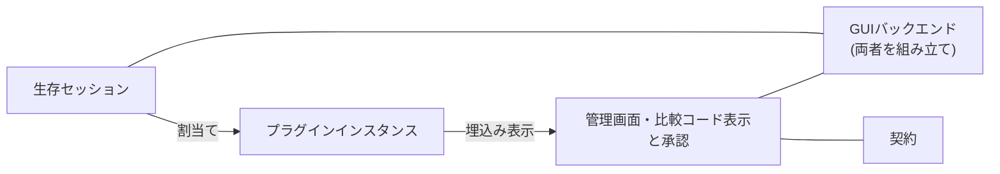
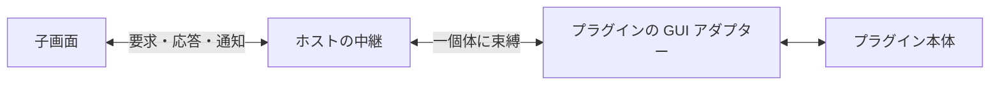
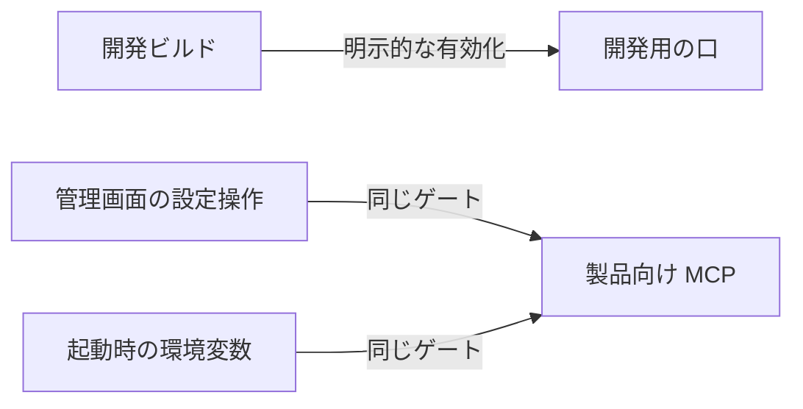

# ブリッジアプリ

アプリの責務分担と、GUI・プラグイン基盤の採用理由をまとめる。

## 構成

- 接続・輸送を担うサーバー、プラグインと割当てを管理するコア、GUI を分ける。通信や割当てを GUI に依存させず、CLI と GUI で共用するためである。
- GUI はホスト、管理画面、共有契約に分ける。デスクトップ固有処理とブラウザ上の表示を切り離し、GUI 基盤を変更してもプラグイン本体への影響を抑える。
- プラグイン開発用 SDK は、ホスト実装に依存せず拡張するための境界とする。共有契約・SDK に実行環境固有の処理を入れず、ワールドや子画面からも必要な契約だけを使えるようにする。
- 各プラグインは、本体・通信契約・子画面を種別ごとにまとめる。種別固有の変更を一か所に閉じ込め、汎用ホストに種別ごとの分岐が増えるのを避ける。同梱する種別の選択だけをホストの組立て箇所に集める。

### 割当ての単純化

セッションと接続口は一対一で結ぶ。分配・合流や通信途中の付替えを扱わず、解除時はセッションを中断することで、未完了の通信が別のプラグインへ混ざるのを防ぐ。再接続にも割当てを引き継がず、新しい通信として扱う。

未割当ての信頼性付き通信は、到着時にセッションを中断する。操作待ちの無制限な保留や、信頼性を期待するデータの黙った破棄を避けるためである。

## 子画面

### 表示期間ごとに作り直す

native Webview の初期化が進まない場合にも、画面の再表示で新しく開始できるようにする。非表示の子画面を保持して復旧・再同期する仕組みより、表示期間ごとに作り直す方が寿命を単純に扱える。

状態の正本はプラグイン本体に置き、子画面は再表示時に現在状態を取得する。未確定の入力は失われるが、画面の破棄で通信や UDP 受信まで止まることは避ける。ここでの非表示はアプリ内の画面・個体切替を指し、OS の最小化や遮蔽とは分ける。

表示期間を世代で区別するのは、高速な切替えや遅延応答で古い画面が復活するのを防ぐためである。同じ表示期間の状態更新だけなら作り直さない。初期化失敗はその子画面に閉じ込め、自動再試行のループではなく、個体ごとの明示的な再試行で復旧する。

### 通信はホストを通すが、内容はプラグインが扱う

ホストは生成・接続・失効を管理し、要求や表示データの内容は各プラグインが扱う。これにより、新しいプラグインを追加してもホストの通信処理を増やさずに済む。子画面の接続先はホストが一個体に固定し、画面から対象を自由に選ぶ仕組みにはしない。

要求の対応付けと応答待ちは Electrobun の RPC を使う。独自の RPC 基盤や、ホスト側の状態キャッシュ・再配信は作らず、初期取得と状態通知の整合はプラグイン側で扱う。初期化の観測にもプラグインからの正常応答を使い、専用の ready 通信は増やさない。ただし、正常応答は描画完了の証明ではない。

## 対象プラットフォームと GUI 基盤

### macOS を優先する

当面は macOS（Apple Silicon）を最優先とする。採用する Electrobun の macOS x64 提供がないため、Intel Mac は対象外とする。

macOS を優先しているのはMacメインで開発しているため。リリース段階までにはWindows、Linuxにも対応させる。GUI と通信コアの分離は保ち、他の実行環境への対応時に通信やプラグイン本体まで作り直すことを避ける。

### Electrobun と Bun

常駐するローカルブリッジとして、配布サイズとメモリ使用量を抑えるため Electrobun と native Webview を選ぶ。軽量性は期待だけで判断せず、実アプリでの計測を採用継続の材料にする。

main の実行には Bun を使う。本構成では Electrobun 既定の Cottontail で画面から main への RPC が成立せず、Bun での実行を選ぶ根拠は[アプリの検証記録](../docs/verification/bridge-app.md)に置く。

ベータ段階・単一メンテナのリスクは許容する。埋込み・配布・実行互換に問題があれば Electron への切替えを検討し、責務の境界は維持する。別プロセスが必要になる場合も、IPC・監視・終了処理の管理コストを含めて見直す。

### プラグインのビルドを独立させる

子画面は各プラグインでビルドし、ホストは完成資産を取り込む。ホストの内部ソースや開発環境を参照させず、種別ごとに実装・ビルドを完結させるためである。管理画面の Angular もプラグインには要求しない。

Electrobun の子画面ランタイムを npm から取得できないため、各プラグインが Hutch の devkit を用意する。この独立性の代わりに、ビルド時の Hutch と初回のネットワーク取得を許容する。実行時の互換性を保つため、ホストとプラグインの Electrobun の版は揃える。

完成資産はホスト内の作業用ディレクトリを経由して包装する。Hutch がパッケージ外からの直接コピーを制限するためであり、開発用のディレクトリ配置を実行時 URL に持ち込まない。

### 信頼範囲を絞る

同梱する信頼済みプラグインに限定し、静的に登録する。動的インストールや非信頼コードの隔離まで扱うと、配布・権限・サンドボックスの管理が必要になるため、初期の基盤には含めない。子 Webview も非信頼コードの隔離境界とは扱わない。

子画面には生のセッションや管理バックエンドを渡さず、束縛した個体の操作だけを公開する。資産 URL と遷移許可はホストが管理し、プラグインの表示にアプリ全体の操作権限を伴わせない。

接続口の適合判定はデータ内容の互換性や権限の証明ではない。接続認可とローカル操作の許可は分ける。UDP 受信では loopback を既定とし、非 loopback の利用には別の明示確認を置くことで、接続承認だけでローカル網へ待受けを広げない。

比較コードは人間が承認対象を目視で対応付けるための表示であり、取得・表示から自動承認しない。比較コードや通信本文をログ・受信記録・永続保存に広げず、接続認可の判断は[ブリッジ接続](bridge-connection.md)にまとめる。

## ローカル操作の口

開発用の操作・観測口と製品向けローカル業務操作 MCP を分けて扱う。待受けの実体はそれぞれ別に持ち、いずれも loopback に限る。要求形式と入口の権限に依存する入力検証、起動ゲート、待受け、MCP 登録は入口ごとに持つ。資格情報は開発用の口だけが持ち、製品向けの口はクライアント認証を要求しない。製品向け工具の入力検証と広告 schema は main の同じ schema 定義から行う。共有するのは、業務処理の既存バックエンドへの委譲と、意味が共通する安全な射影、入口ごとに共通して使える接続前の検査（`Host`・`Origin` など）の補助とする。`Origin` の扱いを含む境界の条件は口ごとに定める。製品向けの口は非ブラウザのクライアントを前提とし、ブラウザ由来の要求を許可しない。

### 開発用の操作・観測口

開発用の AI 向け操作・観測口は開発ビルドで明示的に有効化した隔離実行に限る。任意コード実行ではなく、認証付き loopback 経由の限定操作と安全な表示情報に絞り、製品の権限や本文を観測のために広げない。

### 製品向けローカル業務操作 MCP

- 開発用の口の「開発ビルドに限る」を広げるのではなく、製品用に独立した入口を設ける。
- stable ビルドにも載り、既定で無効とする。
- 製品向けの口はクライアント認証を要求しない。有効化中は、別の利用者（別 UID）を含むローカルプロセスが、到達可能な限り許可操作を利用できる。ローカルプロセスの利用者・クライアントは識別しない。開く範囲を広げる代わり、利用できるのは固定の許可操作に限る。
- 開発用の接続口の認証と stable での非公開は変更しない。
- 操作粒度は業務操作に限り、状態取得と、受付の有効化/無効化、ペアリングの表示、プラグイン割当て/解除、子画面切替えを扱う。許可範囲はこの列挙で尽きており、例示ではない。個別接続の切断・子画面の再試行・有効化・権限変更・アプリ終了は公開しない。DOM クリック・実入力・画素取得は対象外とする（管理画面の節の「開発時の観測」を参照）。
- 有効化は実行単位とする。管理画面の設定操作と起動時に渡す環境変数を同じゲートへの二つの入口とし、有効状態は次回起動へ保存しない。画面から停止した後は、環境変数を理由に同一実行内で自動再開しない。環境変数は起動時に有効化する入口であり、クライアントがアプリを起動する手段ではない。
- 未起動時は接続できず、クライアントがアプリを起動することはない。別途 launcher は作らない。
- 複数起動時は、接続設定を取得した実行だけが対象であり、最新の一個へ自動接続しない。
- 接続設定は管理画面から写す。URL を資格情報や実行固有の識別子として扱わないこと。ポートは解放後に再利用され得るため、古い URL が別の実行に一致し得る。
- MCP の許可はワールド接続の受付と独立であり、MCP を有効にしても受付は有効にならない。
- 承認・拒否は人間の GUI 操作でのみ実行する。MCP には人間操作を案内する工具を掲載するが、呼んでも状態は変わらず定型の案内だけを返す。比較コードの取得・表示から自動承認しない。
- 初版は状態を持たない単一の要求/応答のみとし、バッチ要求（配列）は受け付けず、購読・イベント再送・永続セッション・ジョブ履歴は持たない。各実行操作の正常応答には業務結果・表示要求を採用したかどうかとその対象・世代・操作完了直後の改訂番号を含み、応答時までの不変性や GUI 上での採用・描画の完了は保証しない。改訂番号は操作固有の通番ではなく、変更がなければ進まない場合がある。開発用の DOM 段階観測には依存させない。
- 終了時は待受け個体の操作受付を失効させ、待受を停止する。停止に失敗しても操作は受け付けず、解放が未完了であることを示す。「操作は無効・停止は未完了」を区別できるようにする。
- 保証するのは loopback 束縛・固定の許可操作一覧・応答の情報削減・終了時の操作受付の失効と待受の停止までとする。利用者・クライアントを識別しないことは上記の無認証の扱いどおりであり、到達した操作の実害の範囲は公開工具に限り、承認・任意コード・アプリ終了・通信本文の取得は含まれない。人間の目視確認の代替は保証しない。
- 比較コード本文・通信本文・業務 payload・テキスト本文・例外由来の秘密をログ・受信記録・永続保存・応答に残さない。
- 採らない案は以下である。
  - 開発用接続口への相乗り。stable で開いてはいけない経路との条件管理が複雑になる。
  - 別プロセスの MCP サーバから開発用接続口への中継。stable には中継先が存在せず、別プロセスの管理・発見・終了処理が増える。
  - 常時待受け。既定無効に反するため採らない。
  - 固定資格情報。採用する方式では使わない。
  - 自動発見ファイル。明示の実行選択と手動の写しを維持するため作らない。
  - 画素取得・実入力の自動操作。利用者の要求外であり、native Webview に自動操作の標準経路がない。
  - 管理操作をワールド接続の経路に載せること。接続認可とローカル操作の許可を分ける方針に反する。

## 管理画面

### Angular

管理画面の状態表示・操作・RPC 接続を分けて管理し、テンプレートも含めて検証できる基盤として Angular を使う。変更検知は zoneless と signals を用い、この規模では汎用ストアや Router を追加せず、画面内の状態管理に留める。
React や Svelte より Angular を採用したのは、自動操作のしやすさや、書き方や周辺ライブラリが一通りに定めやすくAI開発で設計がブレにくいと考えたため。

Angular の採用範囲は管理画面に限る。プラグインの小さな子画面にまで同じフレームワークを要求すると、不要な依存とビルド負担が増えるためである。

### pen と UI 部品

画面構成や意匠を視覚的に確認・相談するため、pen を意匠の正本として使う。pen で表せない動作は Angular 側に置き、厳密な一致よりも実装・更新の管理コストを優先する。

shadcn 系の意匠に合わせつつ、操作部品を一から作らずに済むよう、Angular 向けの spartan/ui と Tailwind CSS を使う。部品ソースを取り込んで所有し、必要な見た目の調整はアプリ側で行う。pen にある色・寸法を優先し、読み取れない shadcn 由来の値は spartan の既定値で近似する。

### 開発時の観測

自動検証は契約・テンプレート・DOM の状態までを扱い、native Webview の見え方・フォーカス・操作フローは人間が確認する。DOM の成功を実画面の描画完了とは扱わず、画素取得や実入力の自動化は必要になった時点で検討する。

可視 Webview でのメモリ・起動時間と、配布 dmg からの導線は検証が必要である。バックグラウンドでの新規子画面の初期化も保証せず、前面化やフォーカス奪取で回避しない。
