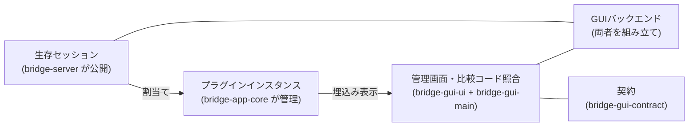

# ブリッジアプリ

アプリの三層責務、プラグインと割当ての契約、GUI境界を決める。

形状（型・フィールド名・操作名・定数値）はコードを正本とし、ここでは複製しない。接続認可・切断失効・サーバー管理境界としての公開は[ブリッジ接続](bridge-connection.md)、輸送・配送・方向・終了の契約は[プロトコル](protocol.md)を正本とする。

三層の関係は、公開された生存セッションを割当てで結び、画面に埋め込む大枠である。画面と backend が共有する手段だけを `bridge-gui-contract` に置き、プラグイン実装者が参照する公開契約は `bridge-gui-plugin-sdk` に置く。同梱の選択と登録順は composition root が宣言する。詳細は本文に置く。

## 三層の責務

| 層                                          | 担うこと                                                                                                                                                                                                                                                     |
| ------------------------------------------- | ------------------------------------------------------------------------------------------------------------------------------------------------------------------------------------------------------------------------------------------------------------ |
| `bridge-server`                             | 接続前検証・ペアリング・Connection認可・輸送・生存セッションの公開・輸送統計                                                                                                                                                                                 |
| `packages/bridge-app-core`                  | プラグイン定義とインスタンス管理、接続口の適合判定、割当て・解除、失効処理、UI非依存の状態と操作、同梱プラグイン。`./core` は具象プラグインを再 export しない汎用 entry であり、ホスト汎用層と公開 SDK はここだけを参照する。root は同梱プラグインも公開する |
| `packages/bridge-gui-contract`              | 共有契約（管理RPC・個体別の共有手段と微少ランタイム）。`management`／`plugin-instance`／`plugin-spike`／`dev-console` の subpath を分ける。`plugin-instance` が持つのは共有手段のみであり、子画面固有契約は持たない                                          |
| `packages/bridge-gui-plugin-sdk`            | プラグイン実装者が参照する公開契約（管理記述子・公開参照口・割当て方針・監視方式・固有操作口・companion 宣言（相対 `viewEntry`）・登録口・資産宣言）。具象 import・副作用・実行実体・ホストパス参照を持たない                                                |
| `apps/bridge-gui-main/src/plugin-ui/<種別>` | プラグイン所有の GUI companion（固有RPC契約・限定DTO・子画面UI・main側アダプター・管理記述子）。`contract.ts`・`companion.ts`・`management.ts`・子画面（`index.ts/html/css`）を一組で持つ                                                                    |
| `apps/bridge-gui-main/src/composition`      | 同梱 composition root。同梱の選択と登録順の宣言（`bundled-plugins.ts`。`plugin-ui` を import してよいのはここだけ）と静的資産 manifest（`bundled-plugin-assets.ts`。platform・companion factory を import しない）を持つ                                     |
| `apps/bridge-gui-ui`                        | 管理画面（mainview）の Angular 実装。契約だけを参照する                                                                                                                                                                                                      |
| `apps/bridge-gui-main`                      | 起動・終了、比較コード照合、Angular 画面の包装・表示、プラグインUIの埋込み、デスクトップ機能、画面との通信                                                                                                                                                   |

- `bridge-app-core` はサーバー管理境界を受け取り、GUIライブラリを参照しない。GUIのバックエンドが両者を組み立てる。
- 埋込み画面（Webview）へ `BridgeServer` や生の `Session` を渡さない。表示用データと限定した操作だけを渡す。
- 依存方向は Angular UI・GUI main・子画面から contract・SDK へ向ける。固有契約（companion の `contract.ts`）も共有契約の共有型・共有手段だけを借りる。contract・SDK から `bridge-app-core`／`bridge-server` への参照は型のみとし、逆依存は持たない。companion から `bridge-app-core` への GUI 逆依存は持たない。SDK は具象プラグインを import せず、既定登録の副作用を持たない。
- contract に Angular・Electrobun の実体、Bun・Node の実行依存、backend を入れない。contract のビルドを `.hutch` に依存させない。Angular UI から GUI ソースへの相対 import はしない。
- プラグイン UI（`plugin-ui/<種別>`）は当面 vanilla のままとし、プラグイン UI 基盤として Angular を必須にしない。固有RPC型・限定DTO・種別トークン・相対資産 entry は `contract.ts`、要望読み・限定射影・操作委譲・要求ハンドラ表は `companion.ts`（factory で `GuiPluginAccess` を capture し backend 引数を持たない）、生成元・割当て方針・監視・表示射影・固有操作の宣言は `management.ts`、子画面本体は `index.ts/html/css` に置き、種別ごとに一組で所有する。解決済み `views://` パス・子画面 URL の組立ては持たない。
- ホストが所有するのは Webview 生成・transport 結線（`BrowserView.defineRPC`）・個体束縛・失効・同梱許可・管理DTO・実 URL 解決である。種別と記述子の対応付けは静的登録表（`apps/bridge-gui-main/src/main/plugin-companions.ts` の `PluginCompanionRegistry`）で引き、汎用管理層（`src/main/plugin-instance-manager.ts` の `PluginInstanceManager`）・汎用結線（`src/main/instance-rpc.ts` の `createCompanionChannel`）・汎用 binder（`src/main/plugin-instances.ts`）・登録表駆動の対応付け（`src/main/plugin-ui-mounts.ts`）・汎用管理操作（`src/main/backend.ts` の `assignPlugin`／`unassignPlugin`）に種別分岐を持たない。同梱の選択と登録は composition root（`src/composition/bundled-plugins.ts`）だけが行い、backend は汎用の登録口だけを受け取る。資産の `views`／`copy` 表は静的 manifest から純粋関数で導き、config から companion factory を import しない。
- 子は対象個体を選べない。子画面が持つのは相対 entry の宣言だけであり、ホストが `views://` へ解決する。companion は解決済み `viewPath` だけを保持し、URL 組立ては汎用の共有手段で行う。遷移規則は登録済み companion の解決済み view パス集合から生成し、`ManagementSnapshot` で `getSnapshot`／状態通知の両経路に載せる。管理画面は採用中 snapshot の値だけを使い、旧固定値や全面許可へ fallback しない。URL の mount 識別子は権限証明ではなく、main が発行した初期URL完全一致＋親 Webview 一致で照合する。子が呼べるのは種別ごとの要求ハンドラ表に載せた要求だけとし、catch-all dispatcher は作らない。子画面生成は native・非 sandbox・preload なし・同梱のみ・静的登録とし、任意URL・HTML・preload は受け付けない。
- 管理画面（mainview）の正本は Angular 実装（`apps/bridge-gui-ui`）であり、vanilla の二重実装・フォールバックは残さない。

## サーバーが公開するセッション口

- 生存セッションの一覧取得と取得口を `BridgeServer` の管理境界に追加する。
- 管理イベントに、セッション開始・セッション終了・接続状態変更を追加する。
- データの購読・送信・終了は既存の Session API（`onMessage`・`onEnd`・`onRemoteEnd`・`sendReliable`・`abort` 等）を再利用し、サーバー独自の登録機構は設けない。
- サーバー起点のセッション作成は公開しない。
- `sessionId` は別接続でも同一接続の終了後でも再利用され得るため、表示・関連付け情報としてのみ扱い、それだけで古い割当てを識別しない。再利用しないローカルのセッション識別子を別途導入する。
- 契約は以下とする。
  - 認可後のセッションだけを公開する。承認成功や切替中は利用開始ではない。
  - 登録を確定してから開始通知、一覧から除外してから終了通知を行う。終了通知は一度だけとする。
  - Connection の終了開始時に全セッションを失効させる。物理切断待ちまで利用可能にしない。
  - FIN は片方向終了であり、全体終了（`onEnd`）と区別する。
  - 通知は購読者の例外を隔離する。購読から一覧取得で初期同期でき、アプリ側は識別子で重複を除く。
- 名称・型の詳細はコードを正本とし、ここでは複製しない。CLI にもセッション公開は波及するが、GUI 向けの割当て操作は CLI に追加しない。

## プラグイン

- プラグインは本体機能と任意の GUI companion を持ち、UI は埋込み Webview として表示する。本体（`packages/bridge-app-core`）は UI・RPC 非依存のままとし、子画面の固有契約・UI・main側アダプター・管理記述子は companion（`plugin-ui/<種別>/` の `contract.ts`・`companion.ts`・`management.ts`・子画面）が所有する。生成・結線・束縛・失効・ライフサイクルはホストの汎用管理層（`PluginInstanceManager`。生成元・割当て方針・監視・表示射影・固有操作の宣言に従って駆動し、種別分岐と任意 payload の汎用ディスパッチ表を持たない）が所有し、子へ生の Session・`BridgeServer`・管理 backend は渡さない。
- 同梱は静的登録であり、動的発見・インストールはしない。登録表への追加に加え、静的資産 manifest（`src/composition/bundled-plugin-assets.ts`）から導く `electrobun.config.ts` の `build.views`＋`copy` への収載が要る。遷移規則の直書き定数は持たず、登録済み companion の解決済み view パス集合から生成して snapshot で配布する。登録だけでは同梱されない。
- レシピ的に扱い、複数インスタンスを出せる。
- 初期対象はリポジトリに同梱する信頼済みプラグインに限る。外部の非信頼プラグイン読込みは対象外とする。
- セッションで送受信するデータの内容やプロトコルに、基盤は関心を持たない。
- 回収に失敗した所有は `cleanupFailed` として表示に残し、自動再試行しない。最終回収はホストの基盤終了に委ね、完全回収は保証しない。

## 接続口と capability

- プラグインは名前付きの接続口を宣言する。各接続口は、受け入れる合法な `kind`・`direction` の組合せを列挙する。二つの独立した集合にはしない。
- 方向は常にワールド・サーバー基準とする。プラグイン基準に読み替えない。
- 現在利用可能な組合せは以下とする。
  - `reliable`・`bidirectional`：PC 側は送受信可能。
  - `latest`・`to_server`：PC 側は受信のみ。
  - `latest`・`to_client`：PC 側は送信のみ。サーバー起点作成をしない今回の範囲では利用不可。
- capability の一致は輸送上の適合にすぎず、データ内容の互換性は保証しない。データの検証・応答相関はプラグインの責務とする。

## 割当て

- 割当てはローカルのセッション識別子からインスタンス識別子と接続口識別子への対応で表す。
- 初期は一対一（一つのセッションに一つの割当て、一つの接続口に一つのセッション）とする。分配・合流は持たない。
- プラグインには割当て期間だけ有効な操作口を渡す。解除後の送信・購読は禁止する。
- 解除・インスタンス削除は対象セッションを中断する。切替えは新しいセッションを使い、未決着通信を混在させない。
- 再接続・同名セッションへ割当てを自動継承しない。
- 未割当ての `reliable` セッションにデータが届いた場合は、理由付きでそのセッションを中断する。GUI 操作待ちの無制限保留や黙った破棄はしない。
- 後から接続するプラグインへの過去値の再配信は保証しない。初期契約は割当て後の受信とする。

## 診断

- 応答確認相当（echo・ping）は `bridge-app-core` の同梱診断プラグインへ移す。プラグイン基盤本体には診断の解釈を持たせない。
- CLI は診断インスタンスを生成・割当てすることで診断用途を維持する。
- 輸送統計から診断 echo・ping の項目を削除する。互換用フィールドは残さない。
- 輸送の keepalive Ping はサーバー側に残す。診断 ping とは別機能である。
- `latest` の記録（内容を解釈しない既存機能）と関連統計は今回維持する。ただし接続をまたぎ切断後も残る記録であり、生存セッションや割当ての判定には使わない。

## 固定テキスト表示

- 固定テキスト表示は `packages/bridge-app-core` の同梱プラグインが行う。接続口は一つで、輸送上の適合は「接続口と capability」節の組合せのうち一つのみ受け付ける。相関・検証・応答期限はプラグイン側の責務とし、サーバー・輸送・基盤本体に追加しない。
- ワールドは認可後に専用セッションを開き、PC からワールドへは相関識別子付きのプレーンテキスト表示要求、ワールドから PC へは同じ識別子の反映確認（本文返送なし）を返す。HTML・Markdown・コマンド解釈はしない。直近一件の置換表示とし、履歴・保存・他利用者への同期はしない。
- 反映確認は「表示用状態に反映した」ことであり、送信 API の成功や描画完了とは区別する。同時実行は一件とし、期限切れ・切断は結果不明として自動再送しない。不正な応答は対象セッションのみ中断し、不正入力は送信前に拒否する。
- 形状・論理名・上限・応答期限・検証規則は契約モジュール（[`packages/bridge-app-core/src/text-contract.ts`](../packages/bridge-app-core/src/text-contract.ts)の公開 subpath）を正本とし、ここでは複製しない。契約モジュールはブラウザ安全な構成とし、ワールドは root import でサーバー依存を引き込まない。公開範囲は[`packages/bridge-app-core/package.json`](../packages/bridge-app-core/package.json)の exports を正本とする。プラグイン本体の振る舞いは[`packages/bridge-app-core/src/plugins/text/plugin.ts`](../packages/bridge-app-core/src/plugins/text/plugin.ts)、ワールド側の受信・表示は[`apps/diagnostic-world/src/text/`](../apps/diagnostic-world/src/text/)を正本とする。
- 割当ては固定プラグイン一種類・同時に一インスタンスとし、開始通知での自動割当てはしない。明示操作でのみ行い、論理名と capability が一致する唯一の候補が全接続を通じて一件だけの場合に割り当て、候補ゼロ・複数は理由付きで拒否する（先着順・一件目・Origin 推測をしない）。解除・インスタンス削除は対象セッションを中断する。再接続後は再承認・新規セッション・新規の明示割当てを要求し、同名でも旧操作口・未完了要求・本文を引き継がない。論理名の一致は内容互換性や真正性の証明ではない。
- 画面は埋込みの子画面（プラグイン UI 埋込み）で行い、管理 Webview 内の暫定 UI は使わない。Webview へ生のサーバー・セッションを渡さない方針を維持し、本文は snapshot・ログ・永続保存に残さない。子画面の表示データ・限定操作の正本はテキスト companion（`apps/bridge-gui-main/src/plugin-ui/text/contract.ts` の固有RPC型・限定DTO・相対 entry と `management.ts` の生成元・割当て方針・監視・表示射影・固有操作）であり、main側アダプターは同じ companion の `companion.ts` を正本とする。限定射影・送信委譲の実体は companion の宣言を汎用管理層が駆動する形で出し、backend が種別固有の射影・送信を持たない。割当て管理はプラグイン一覧が担い、固有の統計・送信状態は子画面に限る。管理RPCの正本は `bridge-gui-contract` の `management` subpath（[`packages/bridge-gui-contract/src/management.ts`](../packages/bridge-gui-contract/src/management.ts)）であり、汎用操作 `assignPlugin`／`unassignPlugin` だけを持つ。子画面の個体別契約には使わない。
- 診断割当てはテキスト表示用セッションを対象外とし、テキスト割当てと排他にする。

## 管理画面の Angular 移行（設計変更）

mainview を Angular に本移行する。本節が設計変更の正本であり、他節は本節に従う。

- 移行方針：既定の管理画面は Angular であり、vanilla 製の旧管理画面は削除済みである。恒久的な二重実装・フォールバックは残さない。
- 契約境界：共有契約（DTO・限定操作・純粋な微少ランタイム＝`selectNewer`、汎用URL組立て／解析、navigation-rules 生成等）を `packages/bridge-gui-contract` へ切り出す。管理契約は汎用操作（`assignPlugin`／`unassignPlugin`）だけを持ち、テキスト固有 DTO・固有操作は持たない。固有の表示・操作は companion に置く。開発専用操作も汎用操作だけを通す。依存方向・禁止は「三層の責務」節を正本とする。
- ビルド：Angular 成果物は UI パッケージ自身の `dist` に生成する（`dist/dev/browser`・`dist/prod/browser` の分離で混在させない）。再帰 `build` に Angular production AOT を含める（`tsc --noEmit` だけではテンプレートを検証できない）。GUI から UI への `workspace:*` ビルド依存を明示する。URL は `views://mainview/index.html` に統一し、Hutch stub＋生成物の写しのコピーとする。成果物が無ければ失敗させる。コピーは生成された chunks／assets を含める。
- Angular 構造：RPC アダプター（接続・型付き request／push。表示状態や DOM を持たない）／状態・操作サービス（signals で snapshot 採用、初期同期、共通操作処理、実行中／失敗表示、安全な受信記録）／表示コンポーネント（状態要約＋受付＋終了、保留一覧・行、接続一覧、表示専用のセッション一覧、割当て管理を行うプラグイン一覧。固有の統計・送信は子画面に限る）／子画面ホスト（登録表駆動の実プラグイン配置・失敗・再試行、段0スパイク操作。共通の対応付け・結線に種別分岐を持たない。タグ同一性保持）／開発専用デバッグアダプター。汎用ストア・ルーターは追加しない。比較コードは保留行の一時状態だけに置き、消滅後の遅延取得は再表示しない。子画面は安定領域へ命令的に追加・削除し、revision 更新で再生成しない。スパイクの起動時自動走行は削除する。
- AI 観測口：開発ビルド＋明示 opt-in＋隔離実行の三条件で有効化する。経路は AI → loopback 接続口 → Bun main → 限定 Webview RPC → 共通操作サービス → 既存管理 RPC → backend とする。`127.0.0.1`・実行ごとランダム token・Origin／Host 制限・入力検証・サイズ／期限制限を設け、ブラウザ向け CORS は開かない。stable は環境変数を設定しても待受けを開かない。許可操作と DTO だけを通し、任意 JS・関数名・DOM 全文・実体取得口は持たない。`ng.*` は可否・件数等の補助観測だけに使う。操作受付・業務結果・snapshot 採用・Angular の DOM 反映は別々に返す（RPC 成功や rAF を描画完了と呼ばない）。native 画素観測は自動化の対象外とし、ここでは扱わない。比較コード取得からの自動承認はしない。汎用ジョブ履歴・再送基盤は作らない。
- 描画確認：native 画素観測（`Screen.captureRegion()` 等）と実入力送信（cliclick／System Events 等）の自動化は行わない（非目標）。`Screen.captureRegion()` はデスクトップ矩形で Webview 単体捕獲ではないため採用しない。自動観測は開発専用の操作・観測口による DOM 観測までとし、固定要素キー・矩形・表示／disabled・`document.hasFocus()`・activeElement キーだけを返し、入力値・本文は返さない。描画・フォーカス・操作フローの最終確認は人間の GUI セッションで行う。
- 確認済み：Hutch のディレクトリコピーは package 内配置で成立する（生成物の写しディレクトリ→`views/mainview/`。`index.html`・`main.js`・`styles.css` の同梱を実測）。package 外の直接指定は `UnsafeOutputPath` で却下されるため、UI の `dist` からの写しを経由する。`@angular/build:unit-test`（Vitest runner）は現 Vite+ override 下で動作し（`ng test --watch=false` が緑）、再帰 `test` に組込済みである。native 画素観測・実入力送信の自動化は非目標として確定し、本項目の対象外とする。
- 未確認事項：可視 Webview 条件下のメモリ・起動時間の再測定、配布 dmg からの導線。

## 管理画面の意匠反映と操作統合（設計変更）

左ナビ＋右コンテンツのシェルと5画面（接続／セッション一覧／プラグイン一覧／プラグイン操作／受信記録）の意匠と操作分担を決める。本節が当該範囲の設計変更の正本であり、他節は本節に従う。形状・型・値はコードと pen を正本とし、ここでは複製しない。

- 意匠の正本分担：意匠は pen（`apps/bridge-gui-ui/pen/sketch.pen`）を SSoT 寄りに運用する。シェル（接続画面を兼ねる）と選択状態ごとの複製画面で5画面を表す。pen で表せない内容は Angular 実装に寄せ、厳密な一致は求めない。
- 意匠基盤：Tailwind CSS v4 と spartan/ui を用いる。`@spartan-ng/brain` に加え、helm ソースを `apps/bridge-gui-ui/src/app/ui/` に取り込んで所有する。導入は採用版を固定した手動取り込みとし、`@spartan-ng/cli` は常設しない。
- テーマ：pen に実値がある色・寸法は pen を採り、pen が参照する shadcn 由来値（pen から読めない分）は採用版 spartan の既定で近似する。`--background`／`--card`／`--foreground`／`--muted-foreground`／`--border`／`--radius` と成功色 `#22c55e` を pen 実値から設定し、実値は pen・コードを正本とする。配色は `light` 固定とし、dark 対応は対象外とする。角丸（12／8／10／6px）は箇所ごとの個別指定であり、単一変数での統一はしない。
- 書体：本文の Inter と受信記録の JetBrains Mono はローカルの WOFF2 同梱とし、実行時の外部取得はしない。許諾全文（OFL）を同梱する。和文はシステム書体へフォールバックする。
- 状態・画面遷移：Router・汎用ストアは追加しない。画面選択は App のローカル signal が持ち、5パネルは常時マウントして表示だけを切り替える。子画面ホスト（`#pluginHost`／`#spikeHost`）は安定要素とし、revision 更新・画面切替で再生成しない。
- 操作統合：セッション一覧は表示専用とし、割当て・解除の操作はプラグイン一覧へ統合する。使用可能種別の正本は採用中 snapshot の `plugins.kinds` とし、静的表は表示補助に留める。追加は一覧の追加操作から接続先セッションを選んで起動と割当てを一体で行う。契約が生成と割当てを一体に持つため、未割当て起動は設けない。起動済み個体の接続先変更は非目標とする。pen の「起動中のプラグイン」カードが接続先の選択 UI を描いているのに対し、接続先変更は非目標であるため実装は現在の接続先の読み取り表示に留め、pen 側は修正せず pen で表せない内容は Angular 実装に寄せる正本分担で吸収する。種別適合の判定は backend が担い、画面は生存セッションから使用中を除いた候補を示すに留める。
- 子画面の表示制御：プラグイン操作画面は個体単位のタブとし、切替ではタグの再生成・DOM 移動・`src` 再設定をしない。`<electrobun-webview>` の公式の可視切替（main の `webviewTagSetHidden`）で制御し、操作画面の選択時かつ選択個体のタグだけを可視とする。開発用の段0子画面（スパイク）のタグも同じ可視制御（`toggleHidden`）の対象とし、操作画面の非選択時に残像として残さない。切替は業務 RPC を送らない。
- 受信記録：記録時刻は管理画面で記録した時刻とし、backend の発生時刻ではない。比較コード本文・ペイロード・DTO 全文はここでは載せず、既存の契約境界を維持する。
- pen の既知誤記：生存セッション画面のシェル参照におけるサイドバー状態行ラベルは pen 側の上書き誤りであり、実装・pen とも「生存セッション」に統一する。
- 検証：型・AOT・TestBed（`ng test`）・再帰 test・check は自動で確認済みとする。native 子 Webview の実表示の見え方は未確認とし、人間の GUI 確認事項として残す。native 画素観測・実入力の自動化は非目標のままとする。

## 対象プラットフォームと GUI 基盤

- 対象は macOS（Apple Silicon）を最優先とする。Electrobun は macOS x64 を提供しないため、Intel Mac は対象外とする。
- GUI 基盤は Electrobun を採用する。実行ランタイムは Bun main、表示は native Webview 1枚とする。Electrobun 既定の Cottontail では Webview→main の RPC が本構成で成立しない観測があり、Bun main で成立することを確認した（観測は[アプリの検証計画](../docs/verification/bridge-app.md)を正本とする）。ベータ段階・単一メンテナというリスクは許容し、埋込み・配布・実行互換に問題が出た場合は Electron へ切り替える。その場合も本節の三層境界は維持する。
- 管理画面（mainview）に Angular を採用する（mainview 限定。プラグイン UI は含まない）。変更検知は zoneless＋signals とする。
- 再帰 `build` に Angular production AOT を含める（`tsc --noEmit` だけではテンプレートを検証できない）。成果物は UI パッケージ自身の `dist` に生成し（dev／prod を分離）、`gui:run`・`gui:build` が選んだ側を Hutch 包装用の写しへ載せ、GUI から UI への `workspace:*` ビルド依存を明示する。
- native 包装・起動は引き続き opt-in とする。
- 非目標は以下とする。サーバー起点のセッション作成、プラグインの動的発見・インストール、非信頼コードの隔離サンドボックス（対象は同梱の信頼済みプラグインのみ）、分配・合流、通信途中のプラグイン付替え、認可や割当ての継承、汎用の接続管理 UI・永続化・複数 Webview 管理（後工程）。
- 将来方針は以下に保つ。同期コアはローカル SDK とし、runner 境界は別契約とする。型の不透明化は通信可能性・安全性・互換性を保証しない。固有要求表を維持し、任意 `invoke` は導入しない。資産の実 URL と遷移許可はホストが所有する。互換目標は固有型の大改修回避とする。

## 文書の正本分担

- 本文書：三層の責務、プラグインと割当ての契約、未割当て・解除方針、GUI 境界、非目標、採用理由と見直し条件。
- [ブリッジ接続](bridge-connection.md)：Connection 認可・切断失効、サーバー管理境界としてのセッション公開。
- [プロトコル](protocol.md)：輸送・配送・方向・終了の契約。
- コード：公開型・フィールド・操作名・データ形状。
- テキスト契約 subpath（`packages/bridge-app-core` の公開するテキスト契約）：固定テキスト表示の形状・論理名・上限・応答期限・検証規則。
- 契約パッケージ（`packages/bridge-gui-contract` の `management`／`plugin-instance`／`plugin-spike`／`dev-console` subpath）：共有GUI契約の形状・検証規則。`plugin-instance` が持つのは共有手段のみとし、子画面の固有契約は持たない。`dev-console` の許可操作は汎用操作だけとする。
- 公開 SDK（`packages/bridge-gui-plugin-sdk`）：管理記述子・公開参照口・割当て方針・監視方式・固有操作口・companion 宣言・登録口・資産宣言の形状。
- 同梱 composition root（`apps/bridge-gui-main/src/composition/bundled-plugins.ts`・`bundled-plugin-assets.ts`）：同梱の選択と登録順、相対 entry から解決済み view パス・`views`／`copy` 表への対応付け。
- 各 companion（`apps/bridge-gui-main/src/plugin-ui/<種別>/contract.ts`）：子画面の固有RPC契約・限定DTO・相対資産 entry の正本。main側アダプターは同じ companion の `companion.ts`（factory で公開参照口を capture する結線アダプター）、管理記述子は同じ companion の `management.ts` を正本とする。
- [接続の検証計画](../docs/verification/bridge-connection.md)：接続の検証計画。[アプリの検証計画](../docs/verification/bridge-app.md)：アプリ固有の観測。

## 見直し条件

- 実行情報：Electrobun で直接実行できるならこの構成で進める。別プロセスが必要なら IPC・監視・終了処理の増加を示して再相談する。埋込み・配布・実行互換に問題があれば Electron へ切り替える。境界は維持する。
- 再相談：ローカル操作を行うプラグイン、非信頼コードの実行、分配・合流、通信途中の付替え、認可や割当ての継承が必要になった場合。
- capability の一致を権限判定として扱わない。既存の接続認可はあらゆるローカル操作の包括承認ではない。
- 観測能力：TestBed（`@angular/build:unit-test` の Vitest runner）と現 Vite+ override の互換は確認済みであり、再帰 `test` に組込済みである。Hutch のディレクトリコピー（package 内配置）は成立を確認済みである。機能移行の完了判断に視覚自動化を含めず、後者を完了扱いしない。native 画素・実入力の自動化が必要になった場合は再検討する。残る未確認は可視 Webview 条件下のメモリ・起動時間の再測定、配布 dmg からの導線である。
