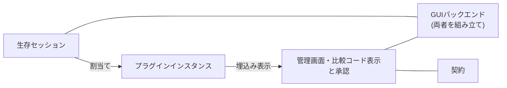
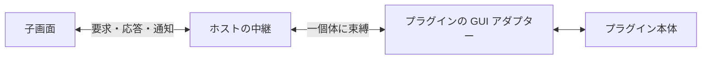

# ブリッジアプリ

アプリの責務分担と、GUI・プラグイン基盤の採用理由をまとめる。

## 構成

- 接続・輸送を担うサーバー、プラグインと割当てを管理するコア、GUI を分ける。通信や割当てを GUI に依存させず、CLI と GUI で共用するためである。
- GUI はホスト、管理画面、共有契約に分ける。デスクトップ固有処理とブラウザ上の表示を切り離し、GUI 基盤を変更してもプラグイン本体への影響を抑える。
- プラグイン開発用 SDK は、ホスト実装に依存せず拡張するための境界とする。共有契約・SDK に実行環境固有の処理を入れず、ワールドや子画面からも必要な契約だけを使えるようにする。
- 各プラグインは、本体・通信契約・子画面を種別ごとにまとめる。種別固有の変更を一か所に閉じ込め、汎用ホストに種別ごとの分岐が増えるのを避ける。同梱する種別の選択だけをホストの組立て箇所に集める。

### 割当ての単純化

セッションと接続口は一対一で結ぶ。分配・合流や通信途中の付替えを扱わず、解除時はセッションを中断することで、未完了の通信が別のプラグインへ混ざるのを防ぐ。再接続にも割当てを引き継がず、新しい通信として扱う。

未割当ての信頼性付き通信は、到着時にセッションを中断する。操作待ちの無制限な保留や、信頼性を期待するデータの黙った破棄を避けるためである。

## 子画面

### 表示期間ごとに作り直す

native Webview の初期化が進まない場合にも、画面の再表示で新しく開始できるようにする。非表示の子画面を保持して復旧・再同期する仕組みより、表示期間ごとに作り直す方が寿命を単純に扱える。

状態の正本はプラグイン本体に置き、子画面は再表示時に現在状態を取得する。未確定の入力は失われるが、画面の破棄で通信や UDP 受信まで止まることは避ける。ここでの非表示はアプリ内の画面・個体切替を指し、OS の最小化や遮蔽とは分ける。

表示期間を世代で区別するのは、高速な切替えや遅延応答で古い画面が復活するのを防ぐためである。同じ表示期間の状態更新だけなら作り直さない。初期化失敗はその子画面に閉じ込め、自動再試行のループではなく、個体ごとの明示的な再試行で復旧する。

### 通信はホストを通すが、内容はプラグインが扱う

ホストは生成・接続・失効を管理し、要求や表示データの内容は各プラグインが扱う。これにより、新しいプラグインを追加してもホストの通信処理を増やさずに済む。子画面の接続先はホストが一個体に固定し、画面から対象を自由に選ぶ仕組みにはしない。

要求の対応付けと応答待ちは Electrobun の RPC を使う。独自の RPC 基盤や、ホスト側の状態キャッシュ・再配信は作らず、初期取得と状態通知の整合はプラグイン側で扱う。初期化の観測にもプラグインからの正常応答を使い、専用の ready 通信は増やさない。ただし、正常応答は描画完了の証明ではない。

## 対象プラットフォームと GUI 基盤

### macOS を優先する

当面は macOS（Apple Silicon）を最優先とする。採用する Electrobun の macOS x64 提供がないため、Intel Mac は対象外とする。

macOS を優先しているのはMacメインで開発しているため。リリース段階までにはWindows、Linuxにも対応させる。GUI と通信コアの分離は保ち、他の実行環境への対応時に通信やプラグイン本体まで作り直すことを避ける。

### Electrobun と Bun

常駐するローカルブリッジとして、配布サイズとメモリ使用量を抑えるため Electrobun と native Webview を選ぶ。軽量性は期待だけで判断せず、実アプリでの計測を採用継続の材料にする。

main の実行には Bun を使う。本構成では Electrobun 既定の Cottontail で画面から main への RPC が成立せず、Bun での実行を選ぶ根拠は[アプリの検証記録](../docs/verification/bridge-app.md)に置く。

ベータ段階・単一メンテナのリスクは許容する。埋込み・配布・実行互換に問題があれば Electron への切替えを検討し、責務の境界は維持する。別プロセスが必要になる場合も、IPC・監視・終了処理の管理コストを含めて見直す。

### プラグインのビルドを独立させる

子画面は各プラグインでビルドし、ホストは完成資産を取り込む。ホストの内部ソースや開発環境を参照させず、種別ごとに実装・ビルドを完結させるためである。管理画面の Angular もプラグインには要求しない。

Electrobun の子画面ランタイムを npm から取得できないため、各プラグインが Hutch の devkit を用意する。この独立性の代わりに、ビルド時の Hutch と初回のネットワーク取得を許容する。実行時の互換性を保つため、ホストとプラグインの Electrobun の版は揃える。

完成資産はホスト内の作業用ディレクトリを経由して包装する。Hutch がパッケージ外からの直接コピーを制限するためであり、開発用のディレクトリ配置を実行時 URL に持ち込まない。

### 信頼範囲を絞る

同梱する信頼済みプラグインに限定し、静的に登録する。動的インストールや非信頼コードの隔離まで扱うと、配布・権限・サンドボックスの管理が必要になるため、初期の基盤には含めない。子 Webview も非信頼コードの隔離境界とは扱わない。

子画面には生のセッションや管理バックエンドを渡さず、束縛した個体の操作だけを公開する。資産 URL と遷移許可はホストが管理し、プラグインの表示にアプリ全体の操作権限を伴わせない。

接続口の適合判定はデータ内容の互換性や権限の証明ではない。接続認可とローカル操作の許可は分ける。UDP 受信では loopback を既定とし、非 loopback の利用には別の明示確認を置くことで、接続承認だけでローカル網へ待受けを広げない。

比較コードは人間が承認対象を目視で対応付けるための表示であり、取得・表示から自動承認しない。比較コードや通信本文をログ・受信記録・永続保存に広げず、接続認可の判断は[ブリッジ接続](bridge-connection.md)にまとめる。

## 管理画面

### Angular

管理画面の状態表示・操作・RPC 接続を分けて管理し、テンプレートも含めて検証できる基盤として Angular を使う。変更検知は zoneless と signals を用い、この規模では汎用ストアや Router を追加せず、画面内の状態管理に留める。
React や Svelte より Angular を採用したのは、自動操作のしやすさや、書き方や周辺ライブラリが一通りに定めやすくAI開発で設計がブレにくいと考えたため。

Angular の採用範囲は管理画面に限る。プラグインの小さな子画面にまで同じフレームワークを要求すると、不要な依存とビルド負担が増えるためである。

### pen と UI 部品

画面構成や意匠を視覚的に確認・相談するため、pen を意匠の正本として使う。pen で表せない動作は Angular 側に置き、厳密な一致よりも実装・更新の管理コストを優先する。

shadcn 系の意匠に合わせつつ、操作部品を一から作らずに済むよう、Angular 向けの spartan/ui と Tailwind CSS を使う。部品ソースを取り込んで所有し、必要な見た目の調整はアプリ側で行う。pen にある色・寸法を優先し、読み取れない shadcn 由来の値は spartan の既定値で近似する。

### 開発時の観測

自動検証は契約・テンプレート・DOM の状態までを扱い、native Webview の見え方・フォーカス・操作フローは人間が確認する。DOM の成功を実画面の描画完了とは扱わず、画素取得や実入力の自動化は必要になった時点で検討する。

AI 向けの操作・観測口は開発ビルドで明示的に有効化した隔離実行に限る。任意コード実行ではなく、認証付き loopback 経由の限定操作と安全な表示情報に絞り、製品の権限や本文を観測のために広げない。

可視 Webview でのメモリ・起動時間と、配布 dmg からの導線は検証が必要である。バックグラウンドでの新規子画面の初期化も保証せず、前面化やフォーカス奪取で回避しない。
