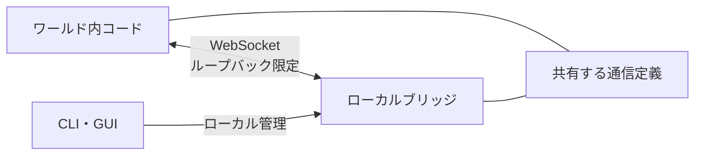
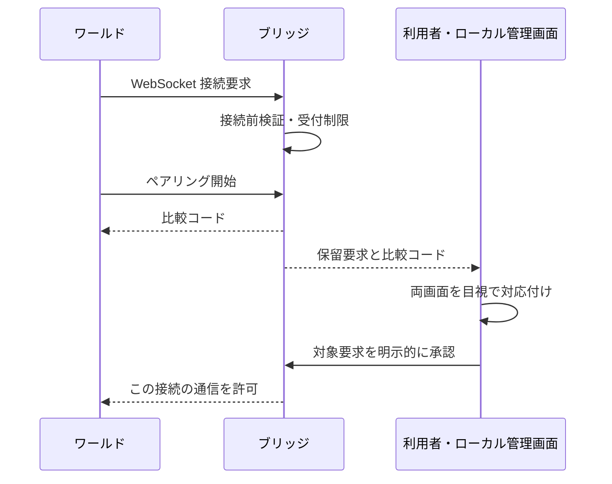

# ブリッジ接続

同じ PC 内のワールドとローカルブリッジをつなぐため、輸送手段と接続認可の採用理由をまとめる。配送と流れ制御は[プロトコル](protocol.md)、GUI とプラグインの構成は[ブリッジアプリ](bridge-app.md)で扱う。

## 構成

ワールドとブリッジを直接つなぎ、外部の中継サービスは挟まない。同じ PC 内で通信を完結させる構成とし、接続の承認はローカル管理側で行う。

クライアントとサーバーは、方向ごとの認可責務が異なるため別々に扱う。輸送の共通部分は共有するが、両者を対称な一つの操作口にまとめる抽象化は重ねない。

## 輸送手段

### WebSocket とループバック

ブラウザから利用できる WebSocket を使い、平文の `ws://` でループバックに限定する。`wss://localhost` は通常の自己署名証明書だけではブラウザから信頼されず、利用者への証明書導入を避ける方針に合わない。

接続先は数値 IP のループバックとする。名前解決への依存を減らし、実際の宛先と XRift 側の許可宣言を揃えるためである。ブラウザ互換性の確認で別のループバック宛先を比較する場合も、LAN 側には待受けを広げない。

ポート競合時は自動探索せず、明示的な設定で解決する。ワールド側の接続先とブリッジの待受けを、利用者が把握できる形に保つ。

### yamux だけを組み合わせる

一つの WebSocket で複数のやり取りを扱うため、yamux の多重化部分を使う。ストリームごとの流れ制御と終了通知を既存ライブラリに任せ、独自の多重化基盤を作らずに済ませる。

libp2p 全体は導入しない。NAT 越えや分散探索は同一 PC 内の接続には不要であり、PeerId と接続単位の認可を対応付ける管理も増えるためである。配送方法と yamux に任せる範囲は[プロトコル](protocol.md)にまとめる。

## 接続の認可

### 接続前検証と人間の承認を分ける

ループバックから届くだけでは、利用者が許可する接続とは判断できない。WebSocket の接続前に接続元・接続先・`Origin` の一致を確認し、その上で人間による承認を組み合わせる。

`Origin` は完全一致で扱い、欠落・`null`・広いパターンでの許可は受け付けない。WebSocket の認可を CORS ヘッダに依存させず、接続前検証で許可するブラウザの接続元を絞る。

### ワールド起点の比較コード

ワールドから開始し、信頼側のブリッジが比較コードを発行して両画面へ表示する。利用者は表示を目視で対応付け、ローカル側で対象要求を承認する。ワールド側へ秘密値を持ち回って入力する手間を避ける方式である。

比較コードは生存中の要求間で重複しないようにし、要求そのものは別の識別子で管理する。ワールド発行のコードだけを承認キーにすると、値の選択・重複・取り違えの扱いが難しくなるため採用しない。

コードの入力・機械的な照合は行わない。操作を簡単にする代わりに、要求の取り違えを機械的に防ぐ仕組みはなく、人間の確認に依存する。表示や通知クリックだけで自動承認せず、承認操作もワールド向けの通信口には公開しない。

比較コードは認証用の秘密値ではなく、承認対象の対応確認に使う。ログ・URL・永続保存へ広げず、両画面への表示に留める。

### 認可を生存中の接続に結び付ける

認可は WebSocket 接続単位とし、切断で失効させる。再接続に認可を引き継がず、長期資格情報や識別子と接続の対応管理を避ける。認可前の通信もペアリング制御に絞り、データやローカル情報は公開しない。

ワールドは XRift ホストと同一文書・同一スクリプト実行基盤で動くため、`Origin` やワールド ID から個々のワールドの真正性は証明できない。同じ実行基盤の悪意あるコードも別接続を開いて比較コードを表示し得る。ワールド退出時の切断は運用上の管理であり、この隔離の代わりにはならない。

承認するのは、その接続での通信である。あらゆるローカル操作の包括承認にはせず、権限を広げる場合は別の判断を置く。MCP の有効化とワールド接続の承認は互いに兼ねず、製品向けの口は[ブリッジアプリ](bridge-app.md)にまとめる。

## 受付と通知の管理

受付は起動時には無効とし、利用者が手動で切り替える。接続要求が常に通知される状態を避け、承認する意思のある間だけ受け付ける。受付を閉じる操作は未認可接続の終了とし、認可済みの通信とは分ける。

保留に期限を設けず、利用者の承認・拒否か切断まで残す。自動失効に頼らない代わりに、接続数・未認可接続数・保留数と受付レートを制限する。受付の切替えでレート履歴を消さず、拒否ごとの通知も出さないことで、枠の占有と通知疲労を抑える。

無期限の保留が枠を占有する可能性は残る。手動切断で管理する範囲とし、悪意ある接続下でも正規要求の受付を保証する設計までは含めない。

## ブラウザと XRift への対応

対象は PC 版 XRift とし、必須のブラウザは Google Chrome に絞る。全ブラウザへの対応は約束せず、Safari などのループバック接続の差は実測で判断する。

XRift の通信許可は実際の宛先と通信処理に合わせて宣言する。ブラウザからの到達性と XRift の審査通過は別に確認し、ブラウザの安全機能を無効化する回避策には依存しない。CSP・ローカル網アクセス・ブラウザ別の結果は[接続の検証記録](../docs/verification/bridge-connection.md)にまとめる。

## 見直し条件

- WebSocket で遅延や詰まりが問題になる場合は WebTransport を比較する。証明書ハッシュ指定を使う場合も、安全な受け渡し・短期証明書の更新・ブラウザ対応・XRift 審査まで含めて判断する。
- 接続範囲や証明書導入の制約が変わる場合は、暗号化と接続先の選び方を見直す。
- NAT 越えや分散探索が必要になる場合は、libp2p 全体の導入を認可境界と合わせて検討する。
- ワールド単位の真正性、認可の継承、ローカル操作への権限拡大が必要になる場合は、比較コード方式の範囲を超えるため認可設計から見直す。
- 常時通知や攻撃下での受付保証が必要になる場合は、手動受付・無期限保留・有限の受付枠の組合せを見直す。
