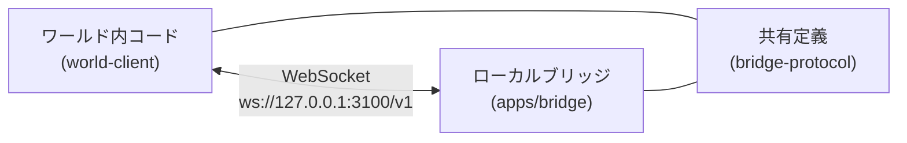
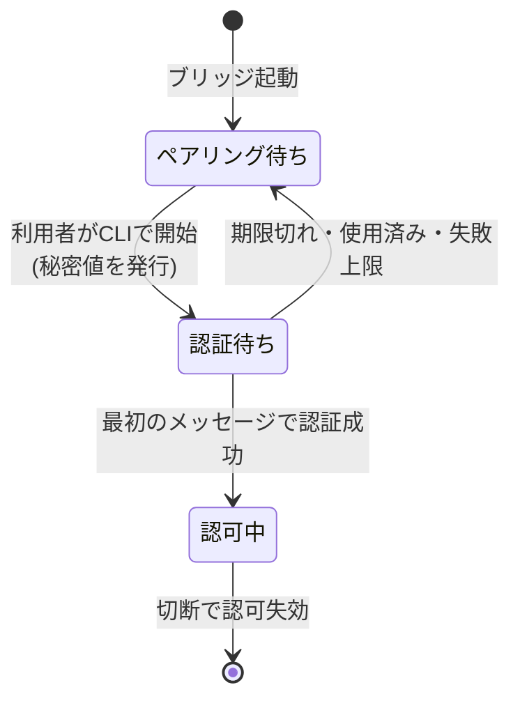

# ブリッジ接続 v0

この文書は初期ブリッジの対象範囲、構成、輸送手段の判断、接続の状態遷移を決める文書である。認証メッセージの形式と配送の振る舞いは [プロトコル v0](protocol-v0.md) を正本とし、証拠の集め方は [検証 v0](verification-v0.md) を正本とする。ここでは要約の複製を作らない。

## 状態

- 確定事項: この文書に「確定」と書いた判断は変更しない。変える場合は設計の見直しが必要である。
- 検証待ち: [検証 v0](verification-v0.md) の観測で確認する事項である。
- 合意待ち: 利用者との合意がまだの事項である。本文では末尾の区分表に集約し、都度の記述では `検証待ち` `合意待ち` と添える。

## 対象範囲

確定事項である。

- 同じパソコン内のブラウザとローカルブリッジをつなぐ範囲に限定する。ループバックの外に出ない。
- 対象物は `packages/world-client`（ワールド内から接続する側）、`apps/bridge`（パソコン上で動く中継）、`packages/bridge-protocol`（両者で共有する定義）である。
- `apps/website` は本件と無関係である。
- 初期の診断版で扱うのは応答確認、模擬のAI出力、センサー交換に限定する。任意のシェル実行や汎用的なファイル操作は実装しない。

## 構成

確定事項である。

- ワールド内コードとブリッジは直接つながる。外部のリレーサーバーを経由しない。
- 共有定義は両者の契約の正本であり、振る舞いの詳細は [プロトコル v0](protocol-v0.md) に置く。
- 信頼境界の前提は以下である。詳細な認証手順は [プロトコル v0](protocol-v0.md) を参照する。
  - 接続時の XRift ホストと、その文書内で動くコードを信頼する。
  - 別オリジンのウェブサイトからの不正な接続は防ぐ。
  - 同一文書・同一スクリプト実行基盤内の悪意あるコードや、ローカルの悪性ソフトからの隔離は保証しない。
  - この前提は利用者が許容済みである。

## 輸送手段の判断

確定事項である。

- 初期の輸送手段は WebSocket に確定する。WebTransport の比較試作は先行させない。
- 平文 `ws://` とし、ループバックに限定する。
- 正規の接続先は `ws://127.0.0.1:3100/v1` である。
- ブリッジの待ち受けは `127.0.0.1` に明示的に結合する。`0.0.0.0` や `::` には結合しない。
- ポートは明示的に設定できる。競合時はエラーを表示し、空きポートの探索はしない。
- `localhost` や `[::1]` は診断時の比較対象である。必要になればループバック限定の別接続先として追加する。
- 初期範囲のクライアントはループバックの接続先のみ受け付ける。
- 数値IPを正規経路にする理由は、名前解決への依存を排除するためである。XRift の宣言も実際の宛先に合わせる必要があり、`localhost` の宣言で `127.0.0.1` まで許可されるとは扱わない。

互換性の扱いは検証待ちである。

- コンテンツセキュリティポリシーの通過は、混合コンテンツやローカル網アクセスの通過を意味しない。
- ホストの `wss://api.xrift.net` の利用実績は、`ws://` ループバック成功の証拠にならない。
- WebKit の課題 171934 は現在も未解決であり、localhost 経路が接続不可の可能性がある。
- Safari を含む全ブラウザでの接続は約束しない。対象の決め方は [検証 v0](verification-v0.md) を正本とする。

## XRift 側で必要な宣言

既知の事実である。審査結果は検証待ちである。

- `xrift.json` の `permissions.allowedDomains` に実際の宛先（`127.0.0.1`、必要に応じ `localhost`）を宣言する。
- `allowedCodeRules` に必要な規則を宣言する。`@xrift/code-security` は構文木解析で fetch、XHR、WebSocket、sendBeacon の未許可領域への通信を検出する。WebTransport は検出規則に記載がなく、審査がどう扱うかは未確認である。
- 実行方式として、ワールドは Module Federation のリモートとしてホスト `app.xrift.net` と同一文書に読み込まれる。
- 実測のコンテンツセキュリティポリシーは `connect-src * blob: data:` である。
- 開発時は `npm run dev` でワールドを `http://localhost:5173` の最上位で実行する。ローカルからループバックへの接続はローカル網アクセスの対象外であり、混合コンテンツの問題もない。

## 接続の状態遷移

確定事項である。認証メッセージの正本は [プロトコル v0](protocol-v0.md) とする。

- ペアリングは接続ごとに行う。永続する資格情報は作らない。
- 成功した WebSocket 接続だけを認可する。切断で認可は失効し、再接続には再ペアリングが必要である。
- ワールドの退出や切替時の切断は運用上の管理であり、同一実行基盤内の悪意あるコードへの防御ではない。
- 通信のペアリングを、あらゆるローカル操作の包括的な許可にはしない。

## 採用しない選択肢と再検討条件

確定事項である。表を一覧の正本とし、本文で重複記述しない。

| 選択肢                         | 今採用しない理由                                                             | 再検討条件                                                                                  |
| ------------------------------ | ---------------------------------------------------------------------------- | ------------------------------------------------------------------------------------------- |
| WebTransport 先行比較          | 性能目標が未確定で、ループバックへの複雑さの増加が先行する                   | 合意した鮮度と遅延を WebSocket が満たせず、待ち行列の制御後も輸送手段由来の停滞が確認された |
| `wss://localhost`              | 通常の自己署名証明書ではブラウザの信頼を確保できず、証明書導入禁止に抵触する | 導入制約または接続範囲が変更された                                                          |
| 全データを一律の先入れ先出し   | センサーの古い値が滞留し、コマンドや AI 出力も巻き込む                       | 採用しない                                                                                  |
| 全センサーの自動間引き         | センサーの意味と欠落許容が未確定である                                       | ストリームごとに利用者が欠落許容を合意した（合意待ち）                                      |
| 永続トークンや切断後の自動再送 | 同一実行基盤で資格情報を長期保持し、コマンドの重複実行も招く                 | 再接続の使い勝手と重複・認可要件を別途合意した                                              |

- WebTransport には証明書のハッシュ指定による導入不要の経路がある。再検討時は対象ブラウザの対応、安全なハッシュ受け渡し、短期証明書の更新、XRift 審査を含めて比較する。

## 区分表

| 区分     | 内容                                                                                                                                                                           | 参照先                        |
| -------- | ------------------------------------------------------------------------------------------------------------------------------------------------------------------------------ | ----------------------------- |
| 確定     | 同一パソコン・ループバック限定、WebSocket 確定、正規接続先と結合先、ポート方針、数値IP理由、状態遷移と認可失効、採用しない選択肢と再検討条件、信頼境界の前提、初期診断版の範囲 | 本文                          |
| 検証待ち | ブラウザごとの接続可否、審査結果、WebTransport 検出規則の扱い                                                                                                                  | [検証 v0](verification-v0.md) |
| 合意待ち | Safari 等を含む必須対応範囲の将来拡大、実測後の欠落許容・鮮度・遅延・負荷範囲、待ち行列容量等の初期暫定値、開発モードの許可Originの列挙場所、配送順決定の具体則                | [検証 v0](verification-v0.md) |

## 利用者合意済みの前提

- 初期対象は同じパソコンのブラウザのみ（ループバック限定）である。
- 必須ブラウザは Chromium 系（Chrome、Edge）のみであり、他は最善努力である。
- 同一実行基盤の信頼前提を許容する。
- 導入許容はブラウザの許可操作とペアリングであり、証明書導入、ブラウザ拡張、外部リレーは不可である。
- 優先するのは広い互換性と簡単な導入である。
