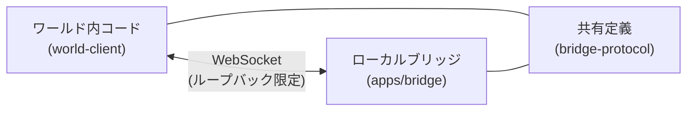
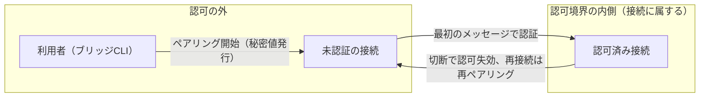

# ブリッジ接続

同一PC内でブラウザ（ワールド内コード）とローカルブリッジをつなぐための設計判断を定める。

形状（フィールド名・型・必須/任意）は `packages/bridge-protocol/src/messages.ts`、外部入力の境界検証は `packages/bridge-protocol/src/validate.ts`、動的契約は各テストを正本とし、ここでは上位の設計判断・採用理由・不採用理由・構造のみを扱う。

## 担当範囲

- 同じパソコン内でブラウザとローカルブリッジをつなぐ。
- 対象は以下
  - `packages/world-client`（ワールド内から接続する側）
  - `apps/bridge`（パソコン上で動く中継）
  - `packages/bridge-protocol`（両者で共有する定義）
- `apps/website` は本件と無関係である。
- 初期の診断版の目標スコープは応答確認、模擬のAI出力、センサー交換である。

## 対応プラットフォーム

- 対象は XRift が動くパソコン版であり、必須は Google Chrome のみである。他は最善努力とする。
- Safari を含む全ブラウザでの接続は約束しない。
- WebKit の課題 171934 は現在も未解決であり、localhost 経路が接続不可の可能性がある。
- ブラウザごとの対応表は観測結果で作る。観測手順は[検証計画](../docs/verification/bridge.md)を正本とする。

## 構成

ワールド内コードとブリッジは直接つながる。両者は共有定義を参照する。

## 輸送手段の判断

- 初期の輸送手段は WebSocket とする。
- 平文 `ws://` とし、ループバックに限定する。
- 正規の接続先は数値IPのループバック宛てとし、ブリッジの待ち受けもループバックに限定する。具体的なホスト・パスの値は `apps/bridge/src/verify.ts`（`BRIDGE_PATH`・`LOOPBACK_HOST`）と `packages/world-client/src/endpoint.ts` を、既定ポートは `apps/bridge/src/index.ts` を正本とする。
- ポートは明示的に設定できる。競合時は探索せずエラーを表示するだけである。
- `localhost` や `[::1]` は診断時の比較対象である。ブラウザ固有の失敗時は、ループバック限定で診断用の接続先・待ち受けを追加してよい（LAN 側へは露出しない）。いつ追加するかは検証計画を参照する。
- 数値IPを正規経路にする理由は、名前解決への依存を排除するためである。XRift の宣言も実際の宛先に合わせる必要があり、`localhost` の宣言で数値IPのループバックまで許可されるとは扱わない。
- 互換性の扱いは検証待ちである。観測手順と対応表の作り方は[検証計画](../docs/verification/bridge.md)を正本とする。

## XRift 側で必要な宣言

- `xrift.json` の `permissions.allowedDomains` に実際の宛先を宣言する。宣言は実際の宛先に合わせ、別接続先を追加した場合も同様である。
- `allowedCodeRules` に必要な規則を宣言する。`@xrift/code-security` は構文木解析で fetch、XHR、WebSocket、sendBeacon の未許可領域への通信を検出する。WebTransport は検出規則に記載がなく、審査がどう扱うかは未確認である（観測手順は[検証計画](../docs/verification/bridge.md)を参照）。
- 実行方式として、ワールドは Module Federation のリモートとしてホスト `app.xrift.net` と同一文書に読み込まれる。
- 開発時は `vp run diagnostic-world#dev` でワールドを `http://localhost:5173` の最上位で実行する（ルートの `dev` は website を起動するため使わない）。
- 設計前提として、ローカルからループバックへの接続はローカル網アクセスの対象外であり、混合コンテンツの問題もない。実測の CSP・ローカル網アクセスの挙動の記録は[検証計画](../docs/verification/bridge.md)を正本とする。

## 接続の認可

- 認可は接続に属し、切断で失効する。再接続には再ペアリングが必要である。
- ペアリングは接続ごとに行う。認証は最初のアプリケーションメッセージで行う。
- 実装の状態名と遷移の詳細は型（`packages/world-client/src/client.ts` の `ConnectionState`）と各テストを正本とする。
- ワールドの退出や切替時の切断は運用上の管理であり、同一実行基盤内の悪意あるコードへの防御ではない。

## 信頼境界

- `Origin` は「そのワールド」の識別に使えない。ワールドはホストと同一文書に読み込まれ、同一スクリプト実行基盤のため隔離できない。
- ワールドID・表示名・SDK 内部変数は認証境界にならない。
- 通信のペアリングを、あらゆるローカル操作の包括的な許可にはしない。

## 採用しない選択肢と再検討条件

| 選択肢                         | 今採用しない理由                                                             | 再検討条件                                             |
| ------------------------------ | ---------------------------------------------------------------------------- | ------------------------------------------------------ |
| WebTransport 先行比較          | 性能目標が未確定で、ループバックへの複雑さの増加が先行する                   | WebSocketで遅延やパケ詰まりが起きる                    |
| `wss://localhost`              | 通常の自己署名証明書ではブラウザの信頼を確保できず、証明書導入禁止に抵触する | 導入制約または接続範囲が変更された                     |
| 全データを一律の先入れ先出し   | センサーの古い値が滞留し、コマンドや AI 出力も巻き込む                       | 採用しない                                             |
| 全センサーの自動間引き         | センサーの意味と欠落許容が未確定である                                       | ストリームごとに利用者が欠落許容を合意した（合意待ち） |
| 永続トークンや切断後の自動再送 | 同一実行基盤で資格情報を長期保持し、コマンドの重複実行も招く                 | 再接続の使い勝手と重複・認可要件を別途合意した         |

- WebTransport には証明書のハッシュ指定による導入不要の経路がある。再検討時は対象ブラウザの対応、安全なハッシュ受け渡し、短期証明書の更新、XRift 審査を含めて比較する。

## 未確定・検証待ち

- 検証待ち・合意待ちの項目、観測手順、対応表の作り方は[検証計画](../docs/verification/bridge.md)を正本とする。

## 関連

- 通信形式・配送・流れ制御の設計判断は[プロトコル](protocol.md)を正本とする。
- 観測手順・試作条件・計測項目・判定後の分岐は[検証計画](../docs/verification/bridge.md)を正本とする。
