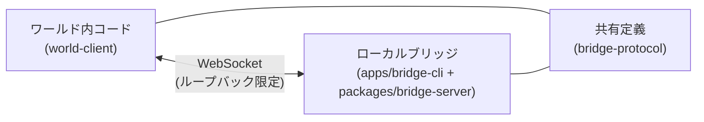
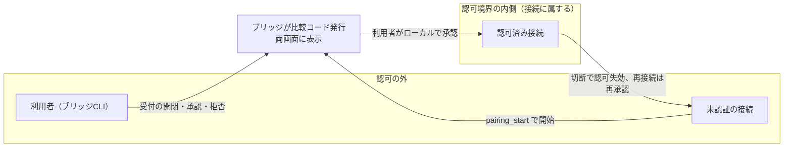

# ブリッジ接続

同一PC内でブラウザ（ワールド内コード）とローカルブリッジをつなぐための設計判断を定める。

形状（フィールド名・型・必須/任意）は `packages/bridge-protocol/src/messages.ts`、外部入力の境界検証は `packages/bridge-protocol/src/validate.ts`、動的契約は各テストを正本とし、ここでは上位の設計判断・採用理由・不採用理由・構造のみを扱う。

## 担当範囲

- 同じパソコン内でブラウザとローカルブリッジをつなぐ。
- 対象は以下
  - `packages/world-client`（ワールド内から接続する側）
  - `packages/bridge-server`（サーバーコア。GUI/CLI が共有する管理境界）
  - `apps/bridge-cli`（CLI 実行アプリ）
  - `packages/bridge-protocol`（両者で共有する定義）
- `apps/website` は本件と無関係である。
- 初期の診断版の目標スコープは応答確認、模擬のAI出力、センサー交換である。

## 対応プラットフォーム

- 対象は XRift が動くパソコン版であり、必須は Google Chrome のみである。他は最善努力とする。
- Safari を含む全ブラウザでの接続は約束しない。
- WebKit の課題 171934 は現在も未解決であり、localhost 経路が接続不可の可能性がある。
- ブラウザごとの対応表は観測結果で作る。観測手順は[検証計画](../docs/verification/bridge.md)を正本とする。

## 構成

ワールド内コードとブリッジは直接つながる。両者は共有定義を参照する。

## 輸送手段の判断

- 初期の輸送手段は WebSocket とする。
- 平文 `ws://` とし、ループバックに限定する。
- 正規の接続先は数値IPのループバック宛てとし、ブリッジの待ち受けもループバックに限定する。具体的なホスト・パスの値は `packages/bridge-server/src/verify.ts`（`BRIDGE_PATH`・`LOOPBACK_HOST`）と `packages/world-client/src/endpoint.ts` を、既定ポートは `apps/bridge-cli/src/index.ts` を正本とする。
- ポートは明示的に設定できる。競合時は探索せずエラーを表示するだけである。
- `localhost` や `[::1]` は診断時の比較対象である。ブラウザ固有の失敗時は、ループバック限定で診断用の接続先・待ち受けを追加してよい（LAN 側へは露出しない）。いつ追加するかは検証計画を参照する。
- 数値IPを正規経路にする理由は、名前解決への依存を排除するためである。XRift の宣言も実際の宛先に合わせる必要があり、`localhost` の宣言で数値IPのループバックまで許可されるとは扱わない。
- 互換性の扱いは検証待ちである。観測手順と対応表の作り方は[検証計画](../docs/verification/bridge.md)を正本とする。

### 多重化に yamux を採用する

- 形状・数値の正本はコードであり、採用値は `packages/bridge-protocol/src/transport/` の各定数を正本とする。
- Session 多重化の手段は **yamux（muxer）のみを自前 WebSocket 上で動かす**方式とする。libp2p スタック（PeerId・Noise・identify・multistream-select）は使わない。採用理由は、必要十分な多重化・流れ制御・終了通知を小さな導入面積で得るためである。WebSocket 維持の判断（前節）と多重化手段の判断（本節）は別の判断として扱う。
- 境界は **既存 JSON でペアリング完了 → 認可（`auth_ok`）→ 同じ WebSocket 上で yamux muxer 開始**とする。別 WebSocket での mux 開始・認可の継承はしない。
- 認可は **Connection（WebSocket 接続）単位のみ**とし、Session 単位の権限は持たせない。切断で失効し、再接続は再承認である（前述の接続認可の判断を維持する）。PeerId に認可を結び付けない理由は、比較コード方式が「生存中の WebSocket 接続そのもの」を承認対象とし、接続単位認可・切断失効と一体で設計されているためである。PeerId を導入すると識別子と接続の対応管理・継承可否の別判断が必要になり、この一体性を崩す。
- `disconnectConnection` は即時切断とする（排出待ちをしない）。対象接続だけを WebSocket code 1008・固定 reason（`packages/bridge-server/src/server.ts` の `OPERATOR_DISCONNECT_REASON` を正本とする）で閉じ、1000ms（`connectionCloseGraceMs`。正本はコード）で強制終了する。他接続・待ち受けは維持する。
- 終了開始後の監視の扱い・code の使い分けは[プロトコル](protocol.md)の終了契約・監視の判断を正本とする。code の意味づけ（1000正常／1001サーバ停止／1008ポリシー／1009 WSメッセージ超過／1011内部障害。1006 は観測値であり送信しない）の詳細も[プロトコル](protocol.md)に置き、ここでは複製しない。
- keepalive は yamux の公開 `ping()` を使う自前の監視ループとし、内蔵 keepalive に障害検知を委ねない（`enableKeepAlive: false`）。間隔・期限・同時 Ping 数の正本は `packages/bridge-protocol/src/transport/keepalive.ts` の定数とする。バックグラウンド停止・スリープで監視切断され再承認が必要になる運用は許容済みである。Ping 成功の意味の限定（往復経路と相手 yamux 処理の動作のみを示す）は[プロトコル](protocol.md)に置く。

## XRift 側で必要な宣言

- `xrift.json` の `permissions.allowedDomains` に実際の宛先を宣言する。宣言は実際の宛先に合わせ、別接続先を追加した場合も同様である。
- `allowedCodeRules` に必要な規則を宣言する。`@xrift/code-security` は構文木解析で fetch、XHR、WebSocket、sendBeacon の未許可領域への通信を検出する。WebTransport は検出規則に記載がなく、審査がどう扱うかは未確認である（観測手順は[検証計画](../docs/verification/bridge.md)を参照）。
- 実行方式として、ワールドは Module Federation のリモートとしてホスト `app.xrift.net` と同一文書に読み込まれる。
- 開発時は `vp run diagnostic-world#dev` でワールドを `http://localhost:5173` の最上位で実行する（ルートの `dev` は website を起動するため使わない）。
- 設計前提として、ローカルからループバックへの接続はローカル網アクセスの対象外であり、混合コンテンツの問題もない。実測の CSP・ローカル網アクセスの挙動の記録は[検証計画](../docs/verification/bridge.md)を正本とする。

## 接続の認可

- 認可は接続に属し、切断で失効する。再接続には再承認が必要である。
- ペアリングは接続ごとに行う。ワールド側から `pairing_start` で開始し、ブリッジが比較コードを発行して両画面に表示し、人間がブリッジ側で承認したその接続だけを認可する。接続前のループバック・接続先一致・`Origin` 完全一致の検証は維持する。具体的な検証内容は `packages/bridge-server/src/verify.ts` と[プロトコル](protocol.md)を正本とする。
- 承認対象は、許可 `Origin` から届いた生存中の WebSocket 接続にブリッジの定めた通信権限を与えることである。ワールド ID・作者・アイテムの真正性を承認するものではない。
- 認可済み接続が行えるのは `data` の送受信である。診断の意味づけ（echo／ping 相当）は `data` の payload 内の `op` で行い、wire に業務 requestId は載せない。形状の正本は `packages/bridge-server/src/diagnostic-handler.ts` とする。任意の将来コマンドやローカル操作の包括承認ではなく、権限拡張は別途判断する。
- 実装の状態と遷移の詳細は公開 API（`packages/world-client/src/client.ts` の `createConnectionRequest` が返す `ConnectionRequest`・`packages/world-client/src/session.ts` の `SessionProvider`・`Session`）と `packages/world-client/src/client.ts` の内部 phase（`requesting_pairing`・`awaiting_approval`・`authorized`・`closed`）・各テストを正本とする。
- ワールドの退出や切替時の切断は運用上の管理であり、同一実行基盤内の悪意あるコードへの防御ではない。

## 信頼境界

- `Origin` は「そのワールド」の識別に使えない。ワールドはホストと同一文書に読み込まれ、同一スクリプト実行基盤のため隔離できない。
- ワールドID・表示名・SDK 内部変数は認証境界にならない。
- 通信のペアリングを、あらゆるローカル操作の包括的な許可にはしない。
- コード一致は UI に表示された要求との対応確認であり、ワールドの真正性の証明ではない。同一実行基盤の悪意あるコードは別接続を開いてコードを UI に表示し得る。よって「OTP 認証」ではなく「承認対象を人間が照合するための比較コード」である。

## ワールド起点の接続承認（比較コード方式）

- 本節は接続承認方式の設計判断と既定値を記す。形状・境界検証・数値・状態遷移の詳細は正本（`packages/bridge-protocol/src/messages.ts`・`packages/bridge-protocol/src/validate.ts`・`packages/bridge-server/src/config.ts`・`packages/bridge-server/src/pairing.ts`・`packages/bridge-server/src/server.ts`・`packages/world-client/src/client.ts`・各テスト）に置く。
- 比較コードを発行するのはブリッジ（信頼側 PC）であり、ワールド側は生成しない。
- 未認可の接続要求の通知は受付モードを設け、ローカルで受付を開いている間だけ通知・承認を受け付ける。

- **要求**: ワールド側で接続を開始し、ワールド UI と PC（ブリッジ）の両方に同じ比較コードを表示し、人間が PC 側で承認する。現状は CLI、長期的には GUI のポップアップ通知を想定する。
- **採用方式**: ワールドから開始し、ブリッジが比較コードを発行して両画面に表示し、人間がブリッジ側で承認したその接続だけを認可する。接続前のループバック・接続先一致・`Origin` 完全一致の検証は維持する。具体的な検証内容は `packages/bridge-server/src/verify.ts` と[プロトコル](protocol.md)を正本とする。
- **承認対象の定義**: 許可 `Origin` から届いた生存中の WebSocket 接続に、ブリッジの定めた通信権限を与えることである。ワールド ID・作者・アイテムの真正性を承認するものではない。

- **設計既定値**: 下記の値は設計既定値であり、意味・単位と正本への参照が分かる形に留める。
  - **権限範囲**: 認可済み接続が行えるのは `data` の送受信である。診断の意味づけ（echo／ping 相当）は `data` の payload 内の `op` で行い、wire に業務 requestId は載せない。認可はその接続だけに属し、切断で失効し、再接続は再承認である。任意の将来コマンドやローカル操作の包括承認ではなく、権限拡張は別途判断する。
  - **比較コード**: 数字6桁（`000000`〜`999999`）である。内部は6文字の文字列として先頭ゼロを保持し、表示は `123 456` のように区切る。ブリッジが暗号学的乱数で生成する。生存中の保留要求との重複を全 `Origin` を通じて検出して再生成し、最大16回で生成できなければその要求を失敗終了する。同じ要求のコードは変更せず、再発行操作は設けない。コードとは別に、再利用しない要求 ID を設ける。
  - **期限（二段階）**: 接続から開始メッセージまで10秒、比較コード発行から承認まで120秒である。保留の実際の絶対期限は「コード発行＋120秒」と「受付終了時刻」の早い方である。通信・一覧表示・重複開始メッセージで延長せず、開始メッセージは接続につき1回である。開始待ちと承認待ちの制限値は `packages/bridge-server/src/config.ts` の `pairingStartTimeoutMs`・`pairingApprovalTimeoutMs` を正本とする。
  - **上限・受付レート**: 全接続数は8である。未認可接続数（開始待ち＋承認待ち）は2（全8の内数であり、認可済みを追い出さない）、同時保留数（承認待ち）は2である。`Origin` 別受付レートは直近60秒に5回、全 `Origin` 合計は直近60秒に10回である。レートは受付の開閉でリセットしない。超過は保留せず拒否し、拒否ごとの通知は出さず `status` に集計を表示する。
  - **受付モード**: 起動時は閉である。ローカル操作で開き、120秒で自動クローズする。開いている間の再操作は期限を更新せず現在の残時間を表示する。手動／自動クローズで開始待ち・承認待ちをすべて終了する（認可済み接続には影響しない）。閉じている間の新規要求は原則 WebSocket upgrade 時に拒否し、保留・通知しない。承認成功だけでは閉じない。
  - **CLI 操作**: `accept open`／`accept close`／`pending`／`approve <requestId> <6桁コード>`／`reject <requestId>` とする。`approve` は要求 ID と比較コードの両方を指定し、ID・コード・期限・接続の生存・受付状態を照合してその要求だけ承認する。`pending` は要求 ID・`Origin`・区切り付きコード・残時間を表示する。`status` に受付状態・終了時刻・各接続数・拒否集計を追加する。既存の `connections|list`・`disconnect`・`quit|exit` は維持する。承認操作はローカル管理境界だけに置き、ワールド向け WebSocket には公開しない。
  - **再接続**: 切断・ワールド切替・ブリッジ再起動後に認可を継承しない（再承認が必要である）。
- **数値・正本の扱い**: 上記の期限・上限・レート・受付時間の正本は `packages/bridge-server/src/config.ts` の `DEFAULT_LIMITS` とする。コード6桁などの共有形式は `packages/bridge-protocol` の定義・検証（`PAIRING_CODE_LENGTH`・`isPairingCode`・`formatPairingCode`）を正本とし、CLI とクライアントで独自定義しない。設定検証で「保留数 ≤ 未認可数 ≤ 全接続数」等の関係を保証する。
- **信頼境界の限界（重要）**: `Origin` は「そのワールド」の識別に使えない。同一文書・同一実行基盤のため隔離できないことは[信頼境界](#信頼境界)の判断を維持する。同一実行基盤の悪意あるコードは別接続を開いてコードを UI に表示し得る。コード一致は UI に表示された要求との対応確認であり、ワールドの真正性の証明ではない。よって「OTP 認証」ではなく「承認対象を人間が照合するための比較コード」である。
- **認証前通信の原則**: 認証前はデータ・ローカル情報を送受信しない。ペアリングに限定した制御通信（`pairing_start`・`pairing_pending`・認証前エラー）を例外として明記する。
- **DoS・通知疲労**: 接続単位の試行上限・接続数上限（具体値は `packages/bridge-server/src/config.ts` の `DEFAULT_LIMITS`・実装・テストを正本とする）だけでは不足する。`Origin` 別の受付レート、未認証接続数・保留数の別上限、保留の絶対期限、応答しない相手の有限時間での強制終了を要する。通知は受付モード中のみとする。
- **本方式で採らない選択肢（参考）**:

  | 選択肢                                   | 今採用しない理由                                   |
  | ---------------------------------------- | -------------------------------------------------- |
  | コード一致だけで自動認可                 | 利用者の承認がなく、表示要求との対応確認にならない |
  | ワールド発行コードを唯一の承認キーにする | 選択値・重複・取り違えの問題がある                 |

- **GUI への道筋**: ブリッジ内部に「保留一覧・状態通知・承認・拒否」の管理境界を作り、CLI と将来の GUI をその利用者にする。承認 API をワールド用 WebSocket に公開しない。通知クリックだけで自動承認しない。
- **パッケージ分割**: サーバーコアを Node 向けライブラリ `packages/bridge-server` として切り出し、`apps/bridge-cli` と将来の GUI は管理境界 API（`BridgeServer` の openAcceptance/listPending/approvePairing/rejectPairing/onManagementEvent/listConnections/disconnectConnection/getStats 等）の利用者にする。GUI は同一 Node プロセスで直接 import する想定である。`packages/*` から `apps/*` を参照しない。

  | 選択肢                                     | 今採用しない理由                                                                              |
  | ------------------------------------------ | --------------------------------------------------------------------------------------------- |
  | client/server を対称な共通ファサードにする | 方向別の認可責務が異なり、既存の transport 抽象（RawSocket/Connection/Session）と重複するため |

- **再相談条件**: ワールド単位の真正性が必要になった場合、同一実行基盤のリスクを許容できない場合、権限がローカル操作へ拡大する場合、常時通知と有限制限を両立できない場合、再接続への認可継承を求める場合、悪意ある接続下でも正規要求の受付保証が必要になった場合。これらは合意待ちではなく、将来の再相談の条件である。反映先は[プロトコル](protocol.md)と[検証計画](../docs/verification/bridge.md)とする。

## 採用しない選択肢と再検討条件

| 選択肢                                                                | 今採用しない理由                                                                              | 再検討条件                                                                                        |
| --------------------------------------------------------------------- | --------------------------------------------------------------------------------------------- | ------------------------------------------------------------------------------------------------- |
| WebTransport 先行比較                                                 | 性能目標が未確定で、ループバックへの複雑さの増加が先行する                                    | WebSocketで遅延やパケ詰まりが起きる                                                               |
| `wss://localhost`                                                     | 通常の自己署名証明書ではブラウザの信頼を確保できず、証明書導入禁止に抵触する                  | 導入制約または接続範囲が変更された                                                                |
| 全データを一律の先入れ先出し                                          | センサーの古い値が滞留し、コマンドや AI 出力も巻き込む                                        | 採用しない                                                                                        |
| 全センサーの自動間引き                                                | センサーの意味と欠落許容が未確定である                                                        | ストリームごとに利用者が欠落許容を合意した                                                        |
| 永続トークンや切断後の自動再送                                        | 同一実行基盤で資格情報を長期保持し、コマンドの重複実行も招く                                  | 再接続の使い勝手と重複・認可要件を別途合意した                                                    |
| コード一致だけでの自動認可                                            | 利用者の承認がなく、表示要求との対応確認にならない                                            | 人間の承認を介さない用途が生まれた                                                                |
| ワールド発行コードを唯一の承認キーにする                              | 選択値・重複・取り違えの問題がある                                                            | ブリッジ発行と比較できる仕組みを別途合意した                                                      |
| 長期資格情報や認可継承                                                | 切断後の権限継承が誤認を招き、同一実行基盤での長期保持が危険である                            | 再接続の使い勝手と重複・認可要件を別途合意した                                                    |
| full libp2p（PeerId・Noise・identify・multistream-select の一括導入） | 必要十分な多重化に対する導入面積が大きく、PeerId と接続単位認可の対応管理の別判断が必要になる | libp2p の他機能（NAT 越え・分散探索等）が要件になった場合に、認可境界の置き方と合わせて再相談する |

- WebTransport には証明書のハッシュ指定による導入不要の経路がある。再検討時は対象ブラウザの対応、安全なハッシュ受け渡し、短期証明書の更新、XRift 審査を含めて比較する。
- yamux 単体（muxer のみを自前 WebSocket 上で使う方式）は[輸送手段の判断](#輸送手段の判断)で採用しているため、この表には載せない。

## 未確定・検証待ち

- 検証待ち・合意待ちの項目、観測手順、対応表の作り方は[検証計画](../docs/verification/bridge.md)を正本とする。

## 関連

- 通信形式・配送・流れ制御の設計判断は[プロトコル](protocol.md)を正本とする。
- 観測手順・試作条件・計測項目・判定後の分岐は[検証計画](../docs/verification/bridge.md)を正本とする。
