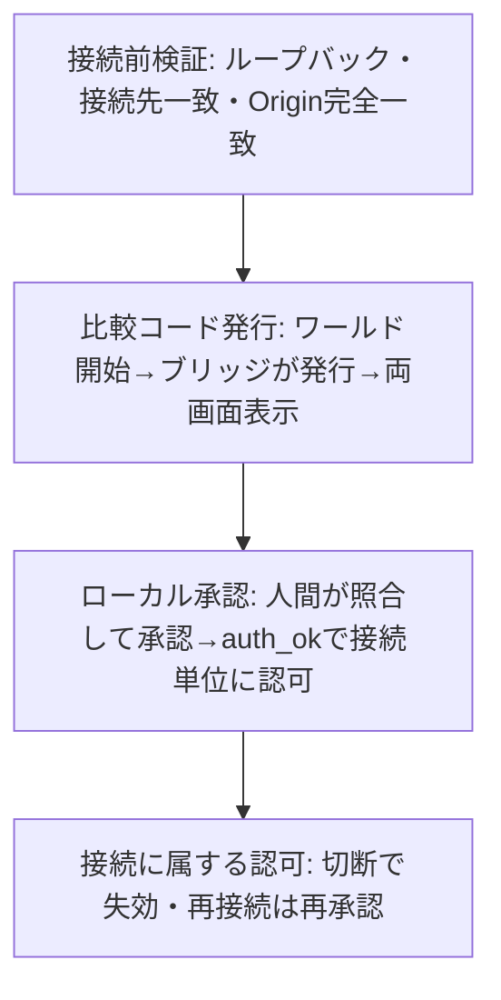
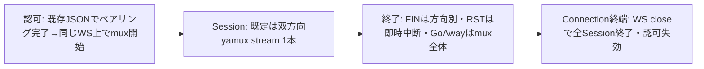

# プロトコル

初期の認証、通信形式、二種類の配送、流れ制御、制限、エラーの扱いについての上位の設計判断を定める。

## 正本の分担

形状（フィールド名・型・必須/任意）は [packages/bridge-protocol/src/messages.ts](../packages/bridge-protocol/src/messages.ts)、
外部入力の境界検証は [packages/bridge-protocol/src/validate.ts](../packages/bridge-protocol/src/validate.ts)、
動的契約は各テスト、上位の設計判断はこの文書を正本とする。
会計式の変数定義・計算式・各分岐での更新は [apps/bridge/src/server.ts](../apps/bridge/src/server.ts) の実装コメントとテストを正本とし、本文に複製しない。

### protocol 0.3 の位置づけ

- WebSocket 上のセッション管理（旧 "Stream" → "Session"）を **yamux on WebSocket（libp2p なし）**へ置き換える破壊的変更を protocol **0.3** として扱う。0.x 台では破壊的変更を許容し、異なるバージョン間の互換設計はしない（ルートの `AGENTS.md` の方針どおり）。
- 本改訂は**採用済みの方向と理由の記録**である。形状・数値の正本は従来どおりコードだが、コードは現状 0.2 のままであり実装は未着手である。調整可能な採用値の置き場は[検証計画](../docs/verification/bridge.md)の暫定値表とし、コード実装後に正本をコードへ移す。
- packages/bridge-protocol/src/messages.example.ts は作業中の構想スケッチ（正本でも語彙の正本でもない）であり、設計判断の根拠として引用しない。

## 用語

本節で Connection／Session／yamux stream の呼び分けを自己完結して定義する。旧称 "Stream" は本節の定義により "Session" と呼ぶ。

- **Connection**＝WebSocket 接続1つ。認可は Connection 単位のみに属し、切断で失効する（[ブリッジ接続](bridge.md)の接続認可の判断を維持する）。
- **Session**＝一連のやりとりの単位。既定は双方向 yamux stream 1本である。
- **yamux stream**＝多重化の輸送単位。論理名（旧 StreamId）と yamux stream ID の対応はアプリが保持する。`latestMailbox`（接続をまたぐサーバ全体記録、キーは論理名）は変更しない。
- 複数の stream を束ねる終了プロトコルは導入しない。

## 判断と理由

### 接続前検証とペアリングを組み合わせる

- WebSocket の昇格前に、接続元がループバックであること、ホスト・ポート・パスが設定した接続先と一致すること、`Origin` の完全一致をいずれも確認する。ループバック到達だけでは利用者の認可の根拠にならないため、接続先の一致確認と明示的なペアリングを組み合わせる。
- WebSocket の安全性を CORS ヘッダに依存させない。CORS を認可の根拠にしない。
- 欠落した `Origin`、`null`、ワイルドカード、接尾辞一致は拒否する方針とする。具体的な符号・書式は型・境界検証・テストを参照する。
- ペアリングはワールド側から `pairing_start` で開始する。開始を受けるとブリッジは比較コードを発行し `pairing_pending` で通知し、人間がブリッジ側（ローカル CLI、将来は GUI）で承認したその接続だけを `auth_ok{requestId,sessionId,window}` で接続単位に認可する。ブリッジが発行するのは暗号学的乱数による数字6桁の比較コードであり、OTP 認証ではない（照合のための比較コード）。旧方式の使い捨て秘密値（ワールド側での入力）は採用しない。なお `window` は 0.2 の形状であり、0.3 ではクレジット層ごと削除方向のため実装時に形状を見直す。
- 認証前はデータとローカル情報を送受信しない。ただしペアリングに限定した制御メッセージ（`pairing_start`・`pairing_pending`・認証前エラー）は例外として送受信する。
- 受付モードは起動時は閉じ、ローカル操作で開き、120秒で自動クローズする。保留の絶対期限は「コード発行＋120秒」と「受付終了時刻」の早い方である。権限範囲は現行同等とし、認可はその接続だけに属し、切断で失効し、再接続は再承認である。これらを設計判断とする。形状・数値・状態遷移の詳細は正本（[packages/bridge-protocol/src/messages.ts](../packages/bridge-protocol/src/messages.ts)・[packages/bridge-protocol/src/validate.ts](../packages/bridge-protocol/src/validate.ts)・[apps/bridge/src/config.ts](../apps/bridge/src/config.ts)・実装・テスト）へ置き、ここでは複製しない。
- 比較コード・要求 ID を URL・クエリ・Cookie・ログ・ブラウザの永続ストレージに入れない。比較コードは両画面への表示と照合にだけ使う。
- 受付レート・未認可接続数・保留数に上限を設け、超過は保留せず拒否する。具体値は `apps/bridge/src/config.ts` の `DEFAULT_LIMITS`・実装・テストを参照する。
- ローカル管理は受付の開閉・保留一覧・要求 ID と比較コードの両方を指定する承認／拒否、接続一覧と接続 ID 指定の切断を提供し、指定接続だけを切断して待ち受けと他接続は維持する。全体停止とは区別する。承認操作はローカル管理境界だけに置き、ワールド向け WebSocket には公開しない。
- 認可は接続単位にする。長期資格情報の保持と、再接続時の誤った権限継承を避けるためである。成功した WebSocket 接続だけを認可し、切断で認可は失効し、再接続には再承認が必要である。
- `Origin` は「そのワールド」の識別に使えない。同一文書・同一スクリプト実行基盤のため、XRift ホストと同じ基盤内のコードから比較コードや通信を隔離できない。コード一致は表示された要求との対応確認であり、ワールドの真正性の証明ではない。ワールド ID・表示名・SDK 内部変数は認証境界にならない。

### 初期は JSON とする（0.2 現行）

- 本節は 0.2 現行の記述であり、0.3 の方向は各項の限定および[認可後の輸送境界と framing](#認可後の輸送境界と-framing03-の方向)・[`reliable` と `latest` を分ける](#reliable-と-latest-を分ける)を参照する。
- 通信形式は初期は JSON とする。バイナリ化は計測後に判断する段階的な対応とし、要否は検証計画を参照する。
- 順序保証はストリーム内とする。異なるストリーム間の全体順序は保証しない。
- コマンド処理結果は要求 ID への明示応答とする（0.2 現行。0.3 では request／response 相関をブリッジ設計に持たせず、echo／command は `data` に一本化する方向である）。
- 切断後の自動再送を採らない。結果不明のコマンドを重複実行しないためである。切断時の未完了コマンドは結果不明として破棄し、通知する。

### 認可後の輸送境界と framing（0.3 の方向）

- ペアリング完了までの既存 JSON によるやりとりは変えない。**認可（`auth_ok` 相当）後に同じ WebSocket 上で yamux muxer を開始する**ことを輸送の境界とする。別 WebSocket での mux 開始・認可の継承はしない。
- yamux stream 上のメッセージ境界は **framing** で定める。固定4-byte長＋JSON本体（UTF-8 シリアライズ）とし、受信時は長さを読んだ時点で検査し、巨大領域を先に確保しない。本体上限の採用値は[検証計画](../docs/verification/bridge.md)の暫定値表に置く。WS `maxPayload` は別の輸送単位（WebSocket メッセージ単位）の制限として扱い、framing とは区別する。
- 超過・壊れた framing・途中 FIN は対象 Session を異常終了する。ローカル送信超過は投入前に拒否する。
- 形状・数値の詳細は実装時にコードを正本とする。ここでは境界と検査の方針のみを定める。

### `reliable` と `latest` を分ける

- 欠落不可の列と、古い値を置換できる状態とで配送を分ける。`reliable` はコマンド・テキスト・AI 逐次出力・欠落不可のセンサー列に使い、ストリーム内の順序を保持する。満杯時は待機または明示エラーとする（0.2 現行の記述であり、件数クレジット前提である。0.3 ではクレジット層削除により前提が変わる）。`latest` は独立した状態のスナップショットに使い、ストリームごとに未送信の古い値を最新値で置換でき、欠番を許容する。配送と遅延の上限は保証しない。
- 欠落許容は明示選択にする。高頻度という理由だけで間引かない。既定は `reliable` とし、`latest` は明示選択とする。位置の絶対値は `latest` に適するが、差分・積分用サンプル・イベントは欠落で意味が壊れ得るため `reliable` にする。
- 0.3 の方向として、`reliable` Session は**双方向**（どちらからも開始可）、`latest` は**一方向**とする。`latest` の置換は yamux 投入前に最新値を置き換える方式とし、投入後の取り消しはしない。WebSocket 送出済みの値は取り消せないため、`latest` も輸送全体の鮮度保証にはならない。この限界は方式選択の前提として残す。
- echo／command は `data` に一本化する方向とし、当面の意味づけは上位層の責務とする。request／response 相関をブリッジ設計に持たせない判断は[不採用](#不採用)に残す。
- `reliable` のアプリ層 `seq` を削除し、`UNEXPECTED_SEQ` 検出を廃止する方向とする。順序は yamux stream に委ねる。判断の記録は[不採用](#不採用)に残す。

### 流れ制御を yamux に寄せる（件数クレジット層は不採用）

- 0.2 の「受信容量に基づく件数クレジット」層（`auth_ok.window`・`credit` メッセージ・サーバ／クライアントの会計エンジン）は**削除する方向**とし、不採用の判断として記録する（[不採用](#不採用)を参照）。理由は、順序・再送・流れ制御を yamux stream に委ねることで層を減らし、独自の会計と通知の行き違い（残量上書き・再通知の進行停止など）の問題ごと排除するためである。
- 新方針として、流れ制御は yamux の window に寄せる。inbound／outbound の合計最大64本の範囲で分け、各方向の本数の内訳は[検証計画](../docs/verification/bridge.md)の暫定値表に置く（独自の合算制限は作らない）。window は自動拡大しない方向とする。ただし採用版のライブラリ既定は RTT 既知で受信 window を自動拡大するため、この方向を実装で守るには `maxStreamWindowSize` を初期 window と同値に明示設定する必要がある（実装時の必須設定であり、決定の変更ではない）。具体的な採用値は[検証計画](../docs/verification/bridge.md)の暫定値表に置き、コード実装後に正本をコードへ移す。
- アプリ層の reliable 件数／バイト待機上限、接続全体の総バッファ上限は**設けない**。総メモリ上限は保証しない。シンプルさを優先し、yamux で扱えない上限は廃止する。
- 唯一の例外として **framing の長さガードは残す**（[認可後の輸送境界と framing](#認可後の輸送境界と-framing03-の方向)を参照）。固定4-byte長＋JSON本体の上限検査であり、受信時に長さを読んだ時点で検査し、巨大領域を先に確保しない。
- 0.2 の待機容量・会計の実装（`apps/bridge/src/server.ts` の実装コメント・テスト）は、0.3 実装時に置き換える対象であり、0.3 の正本ではない。

### 制限とエラーの扱い

- エラーは待機または明示エラーで返し、黙って捨てない。
- 切断時は送受信の待ち行列と未完了の待機を破棄して通知する。

### 終了契約（0.3 の方向）

- **FIN**＝送信方向の正常終了（逆方向は継続可）。双方 FIN＝Session 正常終了（Connection と他 Session は維持する）。
- **RST**＝対象 Session の即時中断（待機送信・未完成フレーム破棄、他 Session は維持する）。
- **GoAway**＝mux 全体の終了通知（Session 終了ではない）。GoAway は相手の mux 終了通知であり、排出保証でも全データ到達保証でもない。受信後は Connection 終了へ進む。
- **WS close／輸送障害**＝Connection 全体終端、全 Session 終了、認可失効。再接続は再承認である。
- 正常終了も業務成功の証明ではない。ブリッジは EOF／中断／Connection 終了を通知し、待機中の送信 Promise を拒否する（二重決着しない）。完了確認できない業務は正常終了時も「結果不明」とする。RST は「未実行」を意味しない。自動再送しない。

### 配送順の保証を撤去する（0.3 の方向）

- 0.2 の「制御優先・接続全体 FIFO」の配送順保証は**撤去する**方向とし、不採用の判断として記録する（[不採用](#不採用)を参照）。同一 stream 内の順序は維持するが、stream 間の順序・公平性・優先度は保証しない。制御専用 stream は作らない。
- 致命的エラーはエラー配送を待たず RST／Connection 終了へ進む（理由の通知はベストエフォート）。

### WebSocket close code の使い分け（0.3 の方向）

- 1000＝正常終了、1001＝サーバ停止、1008＝ポリシー（`disconnectConnection` の即時切断を含む）、1009＝WSメッセージ超過、1011＝内部障害とする。1006 は観測値であり送信しない。
- `disconnectConnection` は排出待ちをせず、1008＋固定 reason で閉じ、1000ms で強制終了する（[ブリッジ接続](bridge.md)の判断を参照）。

### 監視（0.3 の方向）

- yamux の公開 `ping()` を使う自前の監視ループとする。同時 Ping 1件で動かし、不応答で Connection 終端とする。間隔・応答期限の採用値は[検証計画](../docs/verification/bridge.md)の暫定値表に置く。
- 内蔵 keepalive に障害検知を委ねない（`enableKeepAlive: false`）。`enableKeepAlive`／内蔵 keepalive の実挙動が採用版でどう振る舞うかは要確認であり、上流 master は失敗ログのみとする。
- WS Ping との二重監視はしない。独自アプリ heartbeat は追加しない。
- ペアリング期限（認可前）・Ping（認可後）・`connectionCloseGraceMs`（終了開始後）は目的が別である。終了開始で監視を止め、強制終了タイマーは一度だけ動かす。
- Ping 成功は往復経路と相手の yamux 処理が動いたことのみを示し、業務ハンドラ・AI処理・要求完了を保証しない。

### 送信 API 契約（0.3 の方向）

- `reliable` 送信は `Promise<void>` を返し、stream 内で直列化して下位 backpressure を待つ。成功＝ローカル送信処理完了であり、相手の受信・業務完了ではない。
- `sendLatest` は同期受付を維持する（検証後、yamux 投入前に最新値を置換）。戻りは配送完了を意味しない。投入中1件＋未投入最新1件で動く。
- `latest` の非同期失敗は Session／Connection の終端通知で知らせる。値ごとの配送 Promise は作らない。

## 図

接続の確立は、接続前検証・ペアリング認証・接続に属する認可の大枠で進む。

送信から終了までは、認可後の mux 開始・Session 単位の終了・Connection 終端の大枠で進む。符号・数値・全分岐は図に再現しない。

## 不採用

- CORS は認可の根拠にせず、昇格前の検証と明示的ペアリングで認可する。
- 長期資格情報を持たない。認可は接続に属し、切断で失効する。
- コード一致だけで自動認可しない。利用者の承認がなく、表示要求との対応確認にならないためである。
- ワールド発行コードを唯一の承認キーにしない。選択値・重複・取り違えの問題があるためである。
- 使い捨て秘密値をワールドで入力する方式は採用しない。開始・表示・承認の向きをワールド起点の比較コード方式に寄せ、入力の持ち回りをなくすためである。
- 初期のバイナリ化を採らない。計測後に判断する。
- 本物の非信頼データグラムを今は採らない。yamux 投入前置換の `latest` で置換の考え方だけを入れる。
- 切断後の自動再送を採らない。結果不明のコマンドを重複実行しない。
- エラーを黙って捨てない。待機または明示エラーで返す。
- 受信容量に基づく件数クレジット層（`auth_ok.window`・`credit` メッセージ・会計エンジン）を 0.3 で採らない。順序・再送・流れ制御を yamux に委ね、層と行き違い問題ごと排除するためである。
- `reliable` のアプリ層 `seq` と `UNEXPECTED_SEQ` 検出を 0.3 で採らない。順序は yamux stream に委ねるためである。
- request／response 相関をブリッジ設計に持たせない。当面は上位層の責務とし、echo／command は `data` に一本化する方向である。
- 制御優先・接続全体 FIFO の配送順保証を 0.3 で採らない。同一 stream 内の順序のみ維持し、stream 間の順序・公平性・優先度は保証しない。シンプルさを優先するためである。

## 合意待ち・検証待ち

検証待ち・合意待ちの項目一覧は [docs/verification/bridge.md](../docs/verification/bridge.md) を正本とする。

## 正本へのリンク

- 上位の設計判断: この文書（[design/protocol.md](protocol.md)）、全体構成は [design/bridge.md](bridge.md)
- 形状（フィールド名・型・必須/任意）: [packages/bridge-protocol/src/messages.ts](../packages/bridge-protocol/src/messages.ts)（0.3 の形状は未実装のため現状 0.2）
- 外部入力の境界検証: [packages/bridge-protocol/src/validate.ts](../packages/bridge-protocol/src/validate.ts)
- 会計の定義と更新: [apps/bridge/src/server.ts](../apps/bridge/src/server.ts) の実装コメント（0.2 の方式。0.3 実装時に置き換える対象）
- 検証計画（0.3 採用値の暫定値表を含む）: [docs/verification/bridge.md](../docs/verification/bridge.md)
