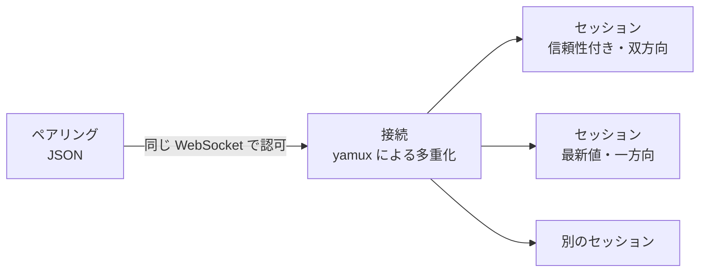
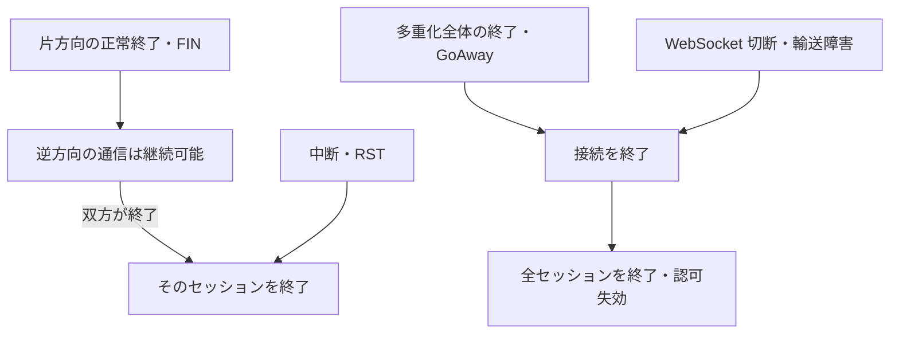

# プロトコル

通信の単位、配送方法、流れ制御と終了の扱いを選ぶ理由をまとめる。輸送手段と接続認可の判断は[ブリッジ接続](bridge-connection.md)で扱い、ここでは認可後の通信を中心にする。

## 接続とセッションを分ける

接続（Connection）は WebSocket 一つ、セッション（Session）は一連のやり取りを表す。セッションを yamux のストリーム一本に対応させ、複数ストリームを束ねる寿命管理を増やさない。

ペアリングは JSON で行い、認可後に同じ WebSocket 上で yamux を開始する。別の接続へ認可を移す必要がなく、接続の寿命と認可を一体で扱える。

## 通信形式と内容の責務

メッセージ本体は JSON とし、ストリーム上では長さを前置してメッセージ境界を示す。バイナリ形式への最適化を先行させず、必要性は計測して判断する。

長さは本体用の領域を確保する前に検査する。WebSocket のメッセージ制限とは輸送の単位が異なるため、ストリーム内のメッセージにも独立した長さの検査を置く。

輸送はデータの内容を解釈せず、診断・コマンド・AI 出力などの要求と応答の対応付けは上位層で行う。プラグインごとのやり取りに、汎用輸送の都合による要求管理を重ねないためである。

## 二種類の配送を使い分ける

### 信頼性付きの `reliable`

コマンド・テキスト・AI の逐次出力・欠落不可のセンサー列には、順序を保つ配送を使う。混雑時も黙って捨てず、送信を待つか明示的なエラーにする。

これを既定にする。高頻度という理由だけでは欠落を許容せず、差分・積分用サンプル・イベントのように、一件の欠落で意味が変わるデータを守る。

### 最新値で置き換える `latest`

位置の絶対値など、各値だけで解釈できる状態には、未送信の古い値を最新値で置き換える配送を明示的に選べるようにする。全データを一律に蓄積すると、古いセンサー値が滞留し、ほかの通信も巻き込むためである。

置換は yamux に投入する前だけで行う。投入済みの値を取り消せないため、本物の非信頼データグラムや通信全体の鮮度保証とは異なる。受信側への到達や遅延上限を保証するものではない。

信頼性付きは双方向、最新値は一方向とする。最新値は送信側と受信側の役割を明確にし、使えない方向の操作は公開型でも区別する。ただし型だけで相手からの不正な通信は防げないため、受信時の検証も行う。

## 流れ制御は yamux に任せる

順序と流れ制御を yamux のストリームに寄せ、独自の件数クレジットや連番検査は重ねない。容量の会計・再通知・状態の行き違いを管理する層を減らすためである。

ストリーム数と受信ウィンドウを制限し、ウィンドウは自動拡大させない。ライブラリの既定動作とは分けて設定し、接続ごとの受信枠が意図せず膨らむのを避ける。

一方、アプリ層の待機件数・待機バイト数や接続全体の総バッファを管理する独自の制限は置かない。実装の単純さとの交換条件として、総メモリ上限の保証は持たない。巨大な一件を受け入れないためのメッセージ長の検査は別に残す。

順序の保証も同じストリーム内に限る。ストリーム間の全体順序・公平性・制御優先の保証や専用スケジューラーを加えず、yamux の多重化をそのまま使う。

## 送信完了と業務完了を区別する

信頼性付き送信は下位の混雑による待機を反映し、同じストリーム内で直列化する。ただし送信処理の成功は、相手の受信や業務処理の完了を意味しない。

最新値の送信は置換対象としての受付を示し、値ごとの配送完了待ちは作らない。置換を許す方式に値ごとの完了保証を混ぜず、非同期の失敗はセッションや接続の終了で知らせる。

切断後の自動再送は行わない。送信や通信終了だけでは処理済みか判断できず、結果不明のコマンドを重複実行する危険がある。業務上の反映確認・期限・再試行の判断は、そのデータを扱う上位層に置く。

## 終了と障害の範囲

方向別の終了とセッション全体の中断を分け、個別の通信終了をほかのセッションへ波及させない。壊れたメッセージ境界や未完成メッセージも、対象セッションの異常として扱う。

接続全体の終了では、物理的な切断完了を待たずに送受信とセッションの利用を止める。遅延した処理が終了中の接続を使い続けるのを防ぎ、待機中の処理も一度だけ決着させる。

正常終了・中断のどちらも業務結果の証明にはしない。正常終了は処理成功を、中断は未実行を意味しない。GoAway も、全データの排出や到達を保証する通知とは扱わない。

利用者による切断や致命的エラーでは、データの排出・理由の配送を待たずに終了へ進む。終了を優先し、理由の通知は最善努力とする。通常の終了処理が進まない場合に備え、強制終了までの待機にも上限を置く。

## 接続の監視

yamux の Ping を使い、不応答を検出したら接続を終了する。失敗を接続終了へ確実につなぐため、ライブラリ内蔵の keepalive に任せず監視ループを持つ。WebSocket Ping や独自の業務用 heartbeat は重ねない。

Ping で確認できるのは往復経路と相手の yamux 処理までであり、業務ハンドラや AI 処理の完了ではない。業務ごとの応答期限とは分ける。

スリープやバックグラウンド停止でも監視切断と再承認が起こり得る運用を許容する。認可前の保留期限、認可後の生存監視、終了開始後の強制終了は別の目的として扱う。保留の扱いは[ブリッジ接続](bridge-connection.md)にまとめる。

## 見直し条件

- JSON の変換やデータ量が問題になる場合は、実測を基にバイナリ化を検討する。
- 最新値の鮮度やストリーム間の公平性が必要になる場合は、yamux 投入前の置換だけで足りるか、輸送の選択から見直す。
- 総メモリ上限の保証が必要になる場合は、yamux のウィンドウだけでなく、アプリ側の待機と接続全体のバッファを含めて設計する。
- 再接続後の再送が必要になる場合は、業務結果の確認と重複実行防止を上位層で設計する。

負荷・配送・終了・監視の観測方法と結果は[接続の検証記録](../docs/verification/bridge-connection.md)にまとめる。
