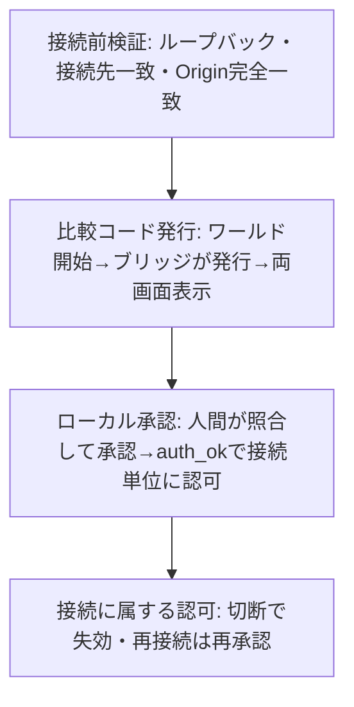

# プロトコル

初期の認証、通信形式、二種類の配送、流れ制御、制限、エラーの扱いについての上位の設計判断を定める。

## 正本の分担

形状（フィールド名・型・必須/任意）は [packages/bridge-protocol/src/messages.ts](../packages/bridge-protocol/src/messages.ts)、
外部入力の境界検証は [packages/bridge-protocol/src/validate.ts](../packages/bridge-protocol/src/validate.ts)、
動的契約は各テスト、上位の設計判断はこの文書を正本とする。
会計式の変数定義・計算式・各分岐での更新は [apps/bridge/src/server.ts](../apps/bridge/src/server.ts) の実装コメントとテストを正本とし、本文に複製しない。

## 判断と理由

### 接続前検証とペアリングを組み合わせる

- WebSocket の昇格前に、接続元がループバックであること、ホスト・ポート・パスが設定した接続先と一致すること、`Origin` の完全一致をいずれも確認する。ループバック到達だけでは利用者の認可の根拠にならないため、接続先の一致確認と明示的なペアリングを組み合わせる。
- WebSocket の安全性を CORS ヘッダに依存させない。CORS を認可の根拠にしない。
- 欠落した `Origin`、`null`、ワイルドカード、接尾辞一致は拒否する方針とする。具体的な符号・書式は型・境界検証・テストを参照する。
- ペアリングはワールド側から `pairing_start` で開始する。開始を受けるとブリッジは比較コードを発行し `pairing_pending` で通知し、人間がブリッジ側（ローカル CLI、将来は GUI）で承認したその接続だけを `auth_ok{requestId,sessionId,window}` で接続単位に認可する。ブリッジが発行するのは暗号学的乱数による数字6桁の比較コードであり、OTP 認証ではない（照合のための比較コード）。旧方式の使い捨て秘密値（ワールド側での入力）は採用しない。
- 認証前はデータとローカル情報を送受信しない。ただしペアリングに限定した制御メッセージ（`pairing_start`・`pairing_pending`・認証前エラー）は例外として送受信する。
- 受付モードは起動時は閉じ、ローカル操作で開き、120秒で自動クローズする。保留の絶対期限は「コード発行＋120秒」と「受付終了時刻」の早い方である。権限範囲は現行同等とし、認可はその接続だけに属し、切断で失効し、再接続は再承認である。これらを設計判断とする。形状・数値・状態遷移の詳細は正本（[packages/bridge-protocol/src/messages.ts](../packages/bridge-protocol/src/messages.ts)・[packages/bridge-protocol/src/validate.ts](../packages/bridge-protocol/src/validate.ts)・[apps/bridge/src/config.ts](../apps/bridge/src/config.ts)・実装・テスト）へ置き、ここでは複製しない。
- 比較コード・要求 ID を URL・クエリ・Cookie・ログ・ブラウザの永続ストレージに入れない。比較コードは両画面への表示と照合にだけ使う。
- 受付レート・未認可接続数・保留数に上限を設け、超過は保留せず拒否する。具体値は `apps/bridge/src/config.ts` の `DEFAULT_LIMITS`・実装・テストを参照する。
- ローカル管理は受付の開閉・保留一覧・要求 ID と比較コードの両方を指定する承認／拒否、接続一覧と接続 ID 指定の切断を提供し、指定接続だけを切断して待ち受けと他接続は維持する。全体停止とは区別する。承認操作はローカル管理境界だけに置き、ワールド向け WebSocket には公開しない。
- 認可は接続単位にする。長期資格情報の保持と、再接続時の誤った権限継承を避けるためである。成功した WebSocket 接続だけを認可し、切断で認可は失効し、再接続には再承認が必要である。
- `Origin` は「そのワールド」の識別に使えない。同一文書・同一スクリプト実行基盤のため、XRift ホストと同じ基盤内のコードから比較コードや通信を隔離できない。コード一致は表示された要求との対応確認であり、ワールドの真正性の証明ではない。ワールド ID・表示名・SDK 内部変数は認証境界にならない。

### 初期は JSON とする

- 通信形式は初期は JSON とする。バイナリ化は計測後に判断する段階的な対応とし、要否は検証計画を参照する。
- 順序保証はストリーム内とする。異なるストリーム間の全体順序は保証しない。
- コマンド処理結果は要求 ID への明示応答とする。
- 切断後の自動再送を採らない。結果不明のコマンドを重複実行しないためである。切断時の未完了コマンドは結果不明として破棄し、通知する。

### `reliable` と `latest` を分ける

- 欠落不可の列と、古い値を置換できる状態とで配送を分ける。`reliable` はコマンド・テキスト・AI 逐次出力・欠落不可のセンサー列に使い、ストリーム内の順序を保持する。満杯時は待機または明示エラーとする。`latest` は独立した状態のスナップショットに使い、ストリームごとに未送信の古い値を最新値で置換でき、欠番を許容する。配送と遅延の上限は保証しない。
- 欠落許容は明示選択にする。高頻度という理由だけで間引かない。既定は `reliable` とし、`latest` は明示選択とする。位置の絶対値は `latest` に適するが、差分・積分用サンプル・イベントは欠落で意味が壊れ得るため `reliable` にする。
- `latest` の置換の考え方は今入れるが、本物の非信頼データグラムは後回しとする。WebSocket 上での最新値優先の配送である。
- 共通の配送順は制御メッセージを優先し、AI の大量出力とセンサーが互いを無期限に阻害しないよう公平に送ることを意図する。B1 の最小配送順は制御優先と応答 FIFO であり、具体則は合意待ちとする（検証計画を参照）。公平化の実装を約束しない。
- WebSocket 送出済みの値は取り消せないため、`latest` も輸送全体の鮮度保証にはならない。この限界は方式選択の前提として残す。

### 待機容量を有限にし、受信容量に基づくクレジットを使う

- 送信側・受信側の両方に有限の受信箱を置き、送受信の待ち行列を有限に抑える。停滞を無制限の保持へ転嫁しないためである。件数・バイト数・ストリーム数の直接制限に限らず、受付時検査の要素上限から導く有限の上限値でもよく、各待ち行列が独立した 3 種類の上限値を必ず持つ方式には限定しない。
- `reliable` には受信側容量を反映するクレジット・ウィンドウ制御を入れる。クレジットは接続単位であり、全 `reliable` ストリームで共通である。
- `reliable` 受付の件数容量（応答保持を含む）を `C` と表記する。
- `reliable` フレームを実際に送出したときに消費し、ローカル待機への追加では消費しない。`latest`・認証・制御フレームは消費しない。
- クレジットは応答受信やコマンド成功ではなく、受信側で予約していた容量を解放したときに回復する。クライアントからブリッジへの受付容量は未処理応答量ではなくブリッジからクライアントへの credit によって制御される。`credit` 通知は処理完了の応答とは別物であり、クレジットを業務処理完了の保証と誤認させないために処理結果と容量解放は分ける。
- 通知と送信の行き違いでの残量上書きによる過剰送信を防ぐために、残量ではなく累積付与件数を通知する。送信側の古い会計値の誤った再通知による進行停止を防ぐために同値の再通知を無視する。これは輸送順序の逆転を防ぐ目的ではない。
- 業務エラーで拒否した要求の枠は可能な限り解放し、枠を永久に失わせない。具体的な符号・順序・各分岐の処理は実装コメントとテストを参照する。
- クライアントは送信待機中のデータに上限を設ける。上限超過はローカルでの明示エラーとする。このとき、待機枠・クレジット・連番は消費せず、切断もしない。待機データの上限範囲・検査単位・検査対象外の細目は型・実装・テストを参照する。待機データは最大 N 件×各 M バイト（`maxPendingReliable`・`maxMessageBytes`）に収まり、待機総バイトの独立した上限は設けない。この待機上限は待機データの範囲であり、JS ヒープ全体・シリアライズの一時領域・送信済み WebSocket バッファ・未応答管理・ストリーム対応表までは制限しない。クライアントの送信上限とブリッジの受信上限は別設定であり、一致させるための仕組みは設けない。
- 件数 credit は任意サイズの要求が成功する保証ではない。バイト上限は独立したハードリミットである。具体的な符号・通知手段は実装・テストを参照する。
- 最大メッセージ長を制限し、容量の単位は UTF-8 にシリアライズした JSON メッセージのバイト数とする。具体値は `apps/bridge/src/config.ts` の `DEFAULT_LIMITS` と `packages/world-client/src/client.ts` の既定値・型を参照する。

### 制限とエラーの扱い

- エラーは待機または明示エラーで返し、黙って捨てない。
- 切断時は送受信の待ち行列と未完了の待機を破棄して通知する。

## 図

接続の確立は、接続前検証・ペアリング認証・接続に属する認可の大枠で進む。

送信から容量解放までは、待機・受付予約・応答保持・解放の大枠で回る。符号・数値・全分岐は図に再現しない。

## 不採用

- CORS は認可の根拠にせず、昇格前の検証と明示的ペアリングで認可する。
- 長期資格情報を持たない。認可は接続に属し、切断で失効する。
- コード一致だけで自動認可しない。利用者の承認がなく、表示要求との対応確認にならないためである。
- ワールド発行コードを唯一の承認キーにしない。選択値・重複・取り違えの問題があるためである。
- 使い捨て秘密値をワールドで入力する方式は採用しない。開始・表示・承認の向きをワールド起点の比較コード方式に寄せ、入力の持ち回りをなくすためである。
- 初期のバイナリ化を採らない。計測後に判断する。
- 本物の非信頼データグラムを今は採らない。WebSocket 上の最新値優先で置換の考え方だけを入れる。
- 切断後の自動再送を採らない。結果不明のコマンドを重複実行しない。
- エラーを黙って捨てない。待機または明示エラーで返す。

## 合意待ち・検証待ち

検証待ち・合意待ち（`latest` の配送順具体則を含む）の項目一覧は [docs/verification/bridge.md](../docs/verification/bridge.md) を正本とする。

## 正本へのリンク

- 上位の設計判断: この文書（[design/protocol.md](protocol.md)）、全体構成は [design/bridge.md](bridge.md)
- 形状（フィールド名・型・必須/任意）: [packages/bridge-protocol/src/messages.ts](../packages/bridge-protocol/src/messages.ts)
- 外部入力の境界検証: [packages/bridge-protocol/src/validate.ts](../packages/bridge-protocol/src/validate.ts)
- 会計の定義と更新: [apps/bridge/src/server.ts](../apps/bridge/src/server.ts) の実装コメント
- 検証計画: [docs/verification/bridge.md](../docs/verification/bridge.md)
